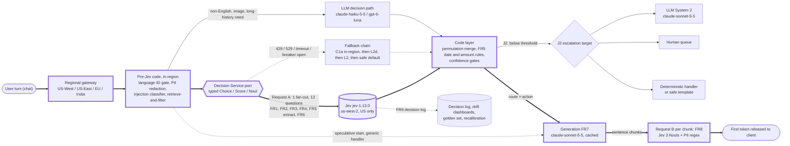

# Design A2: the Jev way (J1, J2) for the real-time support assistant

Status: Phase 2 draft by agent A2, 2026-10-11. **Scope:** primary scenario P (chat) from `requirements.md`. Voice V-casc belongs to A1's voice doc; §9 here covers only how Jev slots into its guardrail. The neutral rungs (C1a, C1b, D1, L3) belong to A3. This document advocates the Jev way, but every claim is held to the ledger.

**Conventions**
- Every number cites a ledger row (`JEV-`, `LLM-`, `ECO-`), a section of `requirements.md` or `PLAN.md`, or carries **[Guessing]** with a range. JEV-105 to JEV-110 are Critic-1's new rows ("New rows to add" in `reviews/phase-1-factcheck-critic.md`), not yet merged into R1; where Critic-1 corrected a row (its V-numbers), the corrected value is used. **[LAB, illustrative]** marks numbers measured in `lab/` on CPU with public data, never production claims.
- **Exact IDs:** Jev `jev-1.13.0`, pinned, never `jev-latest` (JEV-002). Generation (FR7): `claude-sonnet-5-5`, cached, the same tier and caching as the LLM way (R3 BoE, ECO-004); if A1 picks another generation model, swap it in both docs and the J-vs-L delta is unchanged. Fallback LLMs: `claude-haiku-5-5` with thinking disabled (LLM-026) or `gpt-6-luna` at effort `none` (LLM-037). L2d: OpenAI Decisions (`gpt-6-luna` via `/v1/decisions`, LLM-044) and `@cf/cloudflare/clef-flash` (LLM-085).
- **Vendor multipliers are not used.** 193.6× / 444.6× are the vendor's own "higher end" figures with no named comparator; each fits a different plotted point (Sonnet 5 on time, Opus 5 on cost) (JEV-033, Critic-1 V09). 238× is a list-price ratio against `claude-fable-5-1` input (JEV-034, JEV-035).

## 0. Verdict

| | J1: one Jev fan-out per message | J2: J1 plus a calibrated, confidence-gated cascade |
|---|---|---|
| What it is | One typed request answers FR1–FR6 over a filtered state. Code applies vendor-default gates. FR8 is a second small request per reply chunk | The same Jev calls, plus per-decision thresholds fitted on a labelled golden set, escalation to an LLM System 2, a human or code, and a permutation-agreement gate |
| Best at | Day-0 cold start. Typed probabilities with zero labels. Flat latency in question count (JEV-028) | Turning those distributions into controlled automation (risk–coverage), once labels exist |
| Decision-path latency (NFR-1, p95 ≤ 300 ms) | Possible from US-West and US-East **only if** Jev's unpublished service p95 is ≤ about 200–274 ms (§3.1). Fails from the EU and India | Same, plus slow escalations. The p95 holds only if escalations stay below 5% or are rendered as fast deferrals (§4.3) |
| $ per message (decisions + generation) | $0.0039–0.0040 at 1× Jev price. Decisions are 3.2–4.4% of the bill (§3.2) | Plus escalations. Human escalations dominate: 1% of messages adds $0.08–0.23 (ECO-077) |
| Capacity at default limits | **Infeasible at every volume in the default configuration** (headroom 0.59–0.83 at 1M/day); about 1.0 in the lean configuration at 1M/day; 0.01–0.12 at 10M–50M/day (§3.3) | Same Jev load, plus LLM escalation load |
| Ship it? | As a shadow and cold-start layer behind a Decision Service port | **Yes, in US regions**, behind the port, with C1/D1 taking high-volume intents and in-region backends serving the EU and India |

## 1. Family diagram (chat; J1 and J2)

Legend: **thick arrows (`==>`) and thick-bordered nodes mark the critical path** to the first released token. Dotted arrows are fallback or off-path flows. The escalation branch is J2-only.



## 2. Request design

### 2.1 The state object: built by code, filtered, small
Numbers and dates are **deliberately absent** from the state. Code looks them up through `order_ref` (§2.4).

```json
{"turn": {"text": "<redacted user message>", "lang": "en"},
 "recent": [{"role": "user", "text": "..."}, {"role": "agent", "text": "..."}],
 "summary": "<rolling summary, written off-path after each reply>",
 "customer": {"tier": "gold", "open_orders": [{"id": "A-104", "item": "kettle", "status": "delivered"}]},
 "candidate_actions": ["answer_faq","lookup_order","start_return","refund_request","freeze_card","handoff_human","ask_clarifying","close"]}
```

### 2.2 Question map

There is **one fan-out request per message** for the input side (Request A). FR8 needs Request B, because the reply does not exist yet when Request A is sent; that second call is unavoidable and applies to the LLM way too (§11). Questions point at state paths in backticks (for example `` `turn.text` ``), as the vendor's how-to recommends.

| Key | FR | Type | Options or levels | Net tokens | Consumer (the code branch that reads it) |
|---|---|---|---|---|---|
| `inj_attempt` | FR1 | Noul | P(yes) | ~57 (JEV-051) | Input guard: block and send the safe template |
| `self_harm` | FR1 | Noul | P(yes) | ~57 | Crisis flow to a human |
| `abuse` | FR1 | Noul | P(yes) | ~57 | Tone-safe template |
| `pii_present` | FR1 | Noul | P(yes) | ~57 | Audit of the in-region redaction (a second opinion only) |
| `intent` | FR2 | Choice | 15–77 intents + `out_of_scope` + `other` (16–79 options; Choice cap 255, JEV-008) | ~315 at 16 options; ~1,420 at 78 [derived: ~17.8 tokens per option from the ~1,670-token 77-option request, JEV-030, JEV-051] | Router |
| `intent_r` | FR2 | Choice | Same options in reversed order (§2.3) | Same as `intent` | Permutation merge |
| `frustration` | FR3 | Score | 4 levels, 0–3 (≤ 10 allowed, JEV-010) | 75–95 (JEV-051, as corrected in V43) | Priority and tone (off-path) |
| `needs_human` | FR4 | Noul | P(yes), with `true`/`false` criteria | 75–95 | Handoff |
| `order_ref` | FR5 extract | Choice | Open-order IDs from the state + `none_mentioned` + `ambiguous` | 75–95 | Code eligibility (§2.4) |
| `refund_reason` | FR5 extract | Choice | `damaged_on_arrival`, `not_delivered`, `wrong_item`, `changed_mind`, `other`, `not_stated` | 75–95 | Code policy table |
| `item_state` | FR5 extract | Choice | `unopened`, `used`, `damaged`, `not_stated` | 75–95 | Code policy table |
| `next_action` | FR6 | Choice | The 8 values in `candidate_actions` | 75–95 | Orchestrator |
| `next_action_r` | FR6 | Choice | Reversed order | 75–95 | Permutation merge |
| `policy_violation`, `pii_leak`, `tone_violation` | FR8 (Request B) | Noul × 3 | P(yes) | 57–95 each | Hold or release the sentence |

### 2.3 Option-order permutation (against the documented first-option bias, JEV-075)
- **Every Choice gets a seeded random shuffle per request**, with the seed logged. This removes any *systematic* first-position advantage across traffic at zero token cost, and makes the position effect measurable from logs.
- **Routing-critical Choices get a mirror.** FR2 (when ≤ 30 options) and FR6 carry a reversed-order copy in the *same* request; the merged distribution is the mean of the two (permutation averaging in the spirit of PriDe, LLM-074). If the copies disagree on the argmax, the decision is **unstable**: J2 escalates it and never auto-acts. Latency cost ≈ 0 (JEV-028); token cost about +315 (FR2 at 16 options) and +75–95 (FR6).
- **Nouls and Scores are not permuted.** A Noul has no option order, and a Score's level order carries meaning (JEV-010, JEV-056).
- **Taxonomies over 30 options get no intent mirror.** A zero-label, in-region embedding shortlist picks the top 10 intents plus `other`, and only the shortlist is mirrored [Guessing: shortlist recall@10 must be measured]. This also avoids the high-cardinality weakness behind Jev's last-of-17 on 77-way BANKING77 (JEV-087).
- **Eval metric: permutation flip rate** on the golden set (PLAN §4). The lab already implements it (0.18–0.93 on qwen2.5-0.5b [LAB, illustrative]); no Jev flip rate has been published (JEV-075).

### 2.4 FR5: Jev extracts, code compares (JEV-069, JEV-070, JEV-071)
| Sub-task | Owner | How |
|---|---|---|
| Which order the customer means | Jev | `order_ref` Choice over the order IDs placed in the state |
| Reason and item condition | Jev | Enumerated Choices, each with a `not_stated` option |
| Days since delivery ≤ policy window; amount ≤ auto-refund cap; refunds in the last 90 days | **Code** | Read from the order DB through `order_ref`. Never from text |
| Multi-hop rules ("gold tier and not refunded in 90 days unless …") | **Code** (rule table). Exceptions go to J2's System 2 | Indirection is a documented failure mode (JEV-071) |
| A date stated only in free text ("bought in store on the 3rd") | Jev, then code | Month and day as Choices (12 or 31 options, plus `not_stated`), per the vendor's date pattern (JEV-070). Code assembles the date and compares it |
| Any `not_stated`, `ambiguous` or low-confidence field | Code | **Fail closed:** no automatic refund (requirements §4.1) |

### 2.5 Language-ID gate and other pre-Jev routing
- **The gate:** an in-region CPU language-ID step runs before any decision call [Guessing: 1–5 ms]. English with p ≥ 0.9 [Guessing: 0.8–0.95] goes to Jev; Hindi, code-mixed and other languages go to the LLM decision path (structured outputs; in India, the in-region models of LLM-046 and LLM-053).
- **The gate stays until a per-language golden slice passes NFR-7 on Jev.** The vendor says other languages are "handled but not equally well" (JEV-013), and JevBench's Languages view has not been extracted (Critic-1 V61).
- **Image attachments** go to a vision-LLM caption, then to Jev or the LLM path, because Jev takes text only (JEV-012).

### 2.6 Retrieve and filter before Jev (against context rot)
- **State budget:** about 600 tokens by default, hard cap 2,000 [Guessing: 300–2,000]. The 32k vendor limit (JEV-007) is not what binds; **context rot is** (JEV-072).
- **In:** the current turn (redacted), the last 2–4 turns [Guessing], a rolling summary the generation LLM writes off-path, and only the customer fields some question names. **Out:** full history, policy prose (policy lives in the criteria and in code), dates and amounts.
- **History over 32k tokens is never sent.** Code retrieves by order ID or by the last N tickets. A decision that needs multi-hop reasoning over long history goes to the LLM path (requirements §3.3).

## 3. Per-architecture delta (J1 vs J2)

| Row | J1 | J2 (delta from J1) |
|---|---|---|
| **Critical path** | gateway → pre-Jev code → Request A → code gates → generation (TTFT) → Request B on the first chunk → client | Same when confident. An escalated message adds an LLM System 2 call (first chunk 0.88 s at low effort, LLM-008), a human, or a fast deferral template |
| Calls per message | Jev: 1 (A) + 1–2 (B) = 2–3. LLM: 1 (generation) | Plus e_LLM × 1 LLM call, with e_LLM = 5–30% [Guessing] |
| Per-hop latency | §3.1 | Unchanged for confident messages |
| Token flow | §3.2. No caching on Jev (JEV-004); generation cached | Plus about 2–4K tokens per escalated LLM call [Guessing] |
| $ per message | §3.2 | Plus e_LLM × $0.0016–0.004, plus e_human × $8–23 (§3.2) |
| Rate-limit headroom | §3.3 | Same Jev load. LLM escalation needs `claude-sonnet-5-5` rate limits, which are not in the ledger [Guessing] |
| Deadline / retry / fallback / fail mode | §3.4 | Escalation targets are listed in §4.2 |
| Gate thresholds | Vendor defaults: confidence < 0.5 goes to a human; high-stakes actions need > 0.9 (JEV-059, JEV-060) | Fitted per decision on the golden set (§4.1) |

### 3.1 Per-hop latency by gateway region (Request A; 16-intent configuration)

| Gateway | RTT to us-west-2 (P50) | Request A median | Modelled p95 | NFR-1 (p95 ≤ 300 ms) | Flip threshold: Jev service p95 must be ≤ | Design consequence |
|---|---|---|---|---|---|---|
| US-West | 1–9 ms (ECO-073) | 0.10–0.25 s | 0.20–0.73 s | **Undecided.** Passes only with a light tail | ~274 ms | Jev on the critical path |
| US-East | 69–71 ms (ECO-069, ECO-072) | 0.17–0.31 s | 0.28–0.81 s | Borderline to failing | ~200 ms | Jev on path only if a live probe shows service p95 ≤ 200 ms; otherwise the in-region fallback answers first |
| EU | 126–154 ms (ECO-068, ECO-072) | 0.23–0.39 s | 0.35–0.90 s | **Fails** | ~100 ms (the best median would have to *be* the p95) | Jev off the NFR-1 path |
| India | 194–240 ms (ECO-066, ECO-071) | 0.29–0.48 s | 0.43–1.01 s | **Fails by construction** | Below 0 ms: the round trip alone uses the budget at p95 | Jev off path; in-region backends (P1-IN, §8) |

- **Inputs:** Jev service median 0.10–0.24 s (JEV-028, JEV-031); 0.39 s for a 78-option Choice via OpenRouter (JEV-030), so the 77-intent configuration fails NFR-1 everywhere unless the §2.3 shortlist is used.
- **Modelled p95 assumption:** service p95 = 2–3× the median [Guessing]; RTT p95 = 1.2× P50 [Guessing: 1.1–1.5×]; gateway plus code = 15 ms [Guessing: 5–25 ms]; no last mile (ECO-066). No p95 exists for Jev or any LLM decision path (LLM-018; ledger "Known gaps"). The probe locations behind the medians are unstated, so adding RTT is conservative. M1's Monte Carlo replaces this table.
- **Chat TTFT (NFR-2, p95 ≤ 1.0 s):** with speculative generation, Request A overlaps the generation TTFT (0.48–0.88 s, LLM-007, LLM-011, LLM-008), but Request B on the first sentence adds 0.10–0.25 s *serially* in US-West, so the first sentence must be short. NFR-4 (≤ 150 ms for FR8) holds only if the service p95 is ≤ about 140 ms, close to the vendor's "about 100 ms for most queries" (JEV-023), which is unproven at p95.

### 3.2 Token flow and $ per message (Jev $0.042/MTok input, JEV-003; generation $0.0038, R3 BoE via ECO-004)

| Component | Tokens | Source |
|---|---|---|
| Fixed overhead per request | 250–300 | JEV-050 (Critic-1 V41) |
| State (filtered, §2.6) | 300–600 | [Guessing] |
| FR1: 4 Nouls | 4 × 57 = 228 | JEV-051 |
| FR2 intent: 16 options / 78 options | ~315 / ~1,420 | derived from JEV-030 and JEV-051 |
| FR3, FR4, FR5 × 3, FR6: 6 rubric questions | 6 × 75–95 = 450–570 | JEV-051 as corrected by Critic-1 V43 |
| Mirrors (FR2 at 16 options, and FR6) | +315 and +75–95 | §2.3 |
| **Request B per FR8 chunk** (overhead + 100–300 tokens of state [Guessing] + 3 Nouls) | 521–885 | as above |
| Caching | **None on Jev.** The state and rubric are re-billed on every request (JEV-004). Generation: 3,000 cached + 500 uncached input, 250 output | R3 BoE |

| Configuration | Requests per msg | Tokens per msg | Decisions only, at 1× / 3× / 10× Jev price | Decisions + generation, at 1× / 3× / 10× | Decision share at 1× |
|---|---|---|---|---|---|
| Lean: 16 intents, no mirrors, FR8 in 1 chunk | 2 | 2,064–2,898 | $0.000087–0.000122 / $0.00026–0.00037 / $0.00087–0.0012 | $0.0039 / $0.0041–0.0042 / $0.0047–0.0050 | 2.2–3.1% |
| **Default:** 16 intents, both mirrors, FR8 in 2 chunks | 3 | 2,975–4,193 | $0.000125–0.000176 / $0.00038–0.00053 / $0.0012–0.0018 | $0.0039–0.0040 / $0.0042–0.0043 / $0.0051–0.0056 | 3.2–4.4% |
| 77 intents, FR6 mirror only, FR8 in 2 chunks | 3 | 3,763–4,981 | $0.000158–0.000209 / $0.00047–0.00063 / $0.0016–0.0021 | $0.0040 / $0.0043–0.0044 / $0.0054–0.0059 | 4.0–5.2% |

- **Cross-check:** the vendor's own Customer Service workflow uses 2.1K–4.1K tokens and $0.000087–0.000172 per case (JEV-047), matching the default row. R3's single-call BoE ($0.000084 at 2,000 tokens) and Critic-1's ~1,100–1,250-token estimate counted 7 questions in one call; this design counts 13 + 3 questions plus the unavoidable FR8 call.
- **Reference rungs** (R3's single-call basis): cached `claude-haiku-5-5` $0.000091 (ECO-001); cached `gpt-6-luna` $0.000077 (ECO-013); Clef-flash $0.000076 and OpenAI Decisions $0.00020 (ECO-091); cached `claude-sonnet-5-5` decisions $0.0016 (R3 L2m row). **Jev's price edge is real only against the mid tier and above** (about 19×); against the small tier there is none.
- **J2 adds** e_LLM × $0.0016–0.004 (the floor is the Sonnet 5.5 cached decision cost, ECO-004; the extra is reasoning tokens [Guessing]), i.e. +$0.00008–0.0012 at e_LLM = 5–30%. It also adds **e_human × $8–23 (ECO-077)**: at 1% of messages that is +$0.08–0.23 per message, **20–60× the entire J1 bill**. Coverage, not token price, is J2's cost lever.

### 3.3 Rate-limit headroom (defaults 80 req/s and 100K tok/s, JEV-005, JEV-006; peaks from requirements §5)

| Volume | Peak msg/s | Lean: req/s → headroom | Lean: tok/s → headroom | Default: req/s → headroom | Default: tok/s → headroom | Default config needs this multiple of the default limits (1.5× burst margin) |
|---|---|---|---|---|---|---|
| 1M/day | 40.5 | 81 → **0.99** | 84–117K → 0.85–1.20 | 122 → **0.66** | 120–170K → 0.59–0.83 | ~2× requests, ~3× tokens |
| 10M/day | 405 | 810 → 0.10 | 0.84–1.17M → 0.09–0.12 | 1,215 → 0.066 | 1.21–1.70M → 0.06–0.08 | ~23× requests, ~25× tokens |
| 50M/day | 2,025 | 4,050 → 0.020 | 4.2–5.9M → 0.017–0.024 | 6,075 → 0.013 | 6.0–8.5M → 0.012–0.017 | ~114× requests, ~127× tokens |

**Reading the table**
- **Requests bind as tightly as tokens** once FR8 runs on Jev (2–3 requests per message against 80 req/s). Requirements §5.2 assumed one call per message and showed 1.2× at 1M/day; with a realistic call count, **even 1M/day is infeasible at default limits** (lean ≈ 1.0, below the 1.5 burst margin).
- **Enterprise limits are unknown** [Guessing: assume 5–50× default is negotiable]. The vendor says only that "higher limits are available" (JEV-005), and its help centre adds that "a higher rate limit is not a guaranteed fix for overload" (JEV-005). 529 means vendor-side overload, which no limit increase removes (JEV-102).
- **Scale check:** 50M/day × 3 requests is about **1.05B requests a week, about the same as all Jev traffic on OpenRouter (1.03B a week, JEV-107).**
- **Connection pool:** by Little's law, 2,025 msg/s × 3 requests × 0.25 s ≈ 1,500 requests in flight, against an SDK pool default of 100 connections (JEV-100).

**Capacity plan:** (1) PII leak detection in code and one FR8 chunk in chat, giving 2 requests per message; (2) the port spills overflow by priority to C1a or L2d, FR3 first; (3) A3's D1 pattern distils the high-volume intents into in-region C1 once labels exist, and Jev keeps the long tail and new intents [Guessing: Jev then carries 10–30% of traffic]; (4) negotiate limits **before** a 1M/day launch.

### 3.4 Deadlines, retries, fallbacks, fail-open/closed

**Client settings**, overriding the SDK defaults of a 10 s timeout, 2 retries with 0.5–5 s backoff and a 30 s budget (JEV-098, JEV-099):
- Per-call timeout 250 ms in US regions (NFR-6). **0 retries on the critical path**; one retry only if the remaining deadline is at least the observed p50 + 20 ms [Guessing].
- Never retry a 429 or 529 on the path: fall back immediately and do not stack retry loops (JEV-102). Honour `retry-after` only off-path. Hedge Request A after p90 only when request headroom is ≥ 1.5. HTTP/2 with pre-warmed pools (JEV-100).
- Circuit breaker opens at > 5% [Guessing: 2–10%] timeouts, 429s or 529s over 10 s; half-open with 1% probe traffic.

| Decision | Deadline | Fallback chain on 429 / 529 / timeout / breaker open | Fail mode (requirements §4.1) |
|---|---|---|---|
| FR1 injection, self-harm | A: 250 ms | The in-region injection classifier always runs. If uncertain, send the safe template or a human | **Closed** |
| FR1 abuse | A: 250 ms | Classifier, then the tone-safe template | Closed (template) |
| FR1 PII | — | In-region regex/NER runs *before* Jev anyway | Open (redact downstream) |
| FR2 intent | A: 250 ms | C1a in-region, then L2d (OpenAI Decisions has EU processing, LLM-044), then L2, then the generic LLM handler | Fallback chain |
| FR3 urgency | Off-path, 2 s, 2 retries | Default priority | Open |
| FR4 needs a human | A: 250 ms | C1, then offer a human | **Closed** |
| FR5 extraction and eligibility | A: 250 ms | A UI list where the user picks the order. No automatic refund | **Closed** |
| FR6 next action | A: 250 ms | L2d or L2, then the default `ask_clarifying` | Open (default action) |
| FR8 output | B: 150 ms (NFR-4) | Regex PII plus an L2 check off-path. Hold the sentence | **Closed** (safe phrase) |

**EU and India gateways:** the on-path rows use in-region backends first (C1a/C1b, or a self-hosted open-weight decision model, ECO-090). Jev runs off-path for cold-start intents only, with an advisory deadline of 600 ms [Guessing: 400–800 ms].

## 4. J2: the confidence-gated cascade

### 4.1 How thresholds are set, and what "no labels" really buys

| Stage | Thresholds | Evidence |
|---|---|---|
| Day 0, no labels | Conservative vendor defaults: confidence < 0.5 goes to a human; high-stakes actions need ≥ 0.9; a Noul between 0.30 and 0.70 counts as uncertain. Run in shadow mode or with human confirmation | JEV-057, JEV-059, JEV-060 |
| Why day 0 cannot automate | Calibration depends on the task: ECE 0.011 on claims vs 0.108 on LegalBench; 3.5% on BoolQ; 0.138 on BANKING77, overconfident by 12 points | JEV-083, JEV-084, JEV-087 |
| Weeks 1–4: golden set | Labels come from shadow traffic plus human resolution of escalations (the cascade produces its own labels). Size: ≥ ~750 positives per safety class, to pin recall 0.98 to ±0.01 at 95% [Guessing: binomial derivation]; 50–100 per intent [Guessing] | NFR-7 |
| Fit | Per decision: temperature scaling or isotonic regression on a calibration split (LLM-076). On a held-out split, choose τ so the **upper** 95% bound on error meets the target. Vals' frozen threshold for a 1% error budget actually produced 1.6% | JEV-083 |
| Go-live check | ECE ≤ 0.05 with equal-mass bins (NFR-8), and NFR-7 met on the risk–coverage curve | requirements §4 |

**What "no labels" buys: cold start, not automation.** On day 0 Jev returns ordered, roughly calibrated distributions with no labelled data: AUROC 0.811 on BANKING77 (JEV-087), median AUROC 0.886 across 44 alignment benchmarks (JEV-093). That is enough to rank decisions and send the uncertain tail to humans, which is how the first labels get made. It is **not** enough for thresholds you can trust for automation; those need labels on every rung (LLM logprobs need recalibration after RLHF, LLM-071; C1a's ECE falls from 0.144 to 0.012 at N = 50 after temperature scaling [LAB, illustrative]). The edge is a **cold-start and taxonomy-churn edge**, worth most when intents change monthly (requirements Q7).

### 4.2 Escalation target per decision
| Decision | Gate signal | Escalated to | Why that target |
|---|---|---|---|
| FR1 injection | Jev P(yes) **and** the in-region classifier | **Code:** safe template; fail closed. An LLM second check runs off-path | Jev must never be the only control (JEV-073, JEV-106) |
| FR1 self-harm | P(yes) ≥ a recall-tuned τ [Guessing: 0.2–0.35] | **Human** (crisis protocol) plus a template | The cost of a miss is asymmetric |
| FR2 intent | Merged p_max, mirror agreement, top-two ratio | **LLM System 2** (`claude-sonnet-5-5` at effort low, with the intent rubric and history), or a clarifying question from a code template | Ambiguity needs reasoning or the user's input |
| FR4 needs a human | P(yes) in or above the uncertain band | **Human** | Fail closed |
| FR5 extraction | Any field `not_stated`, `ambiguous` or low-confidence | **Code** (the UI pick list), then a human for disputes | Money moves only on facts that code has verified |
| FR5 eligibility exception | A rule needs judgement (a multi-hop exception) | **LLM System 2** proposes; a human approves above the refund cap | Indirection (JEV-071) |
| FR6 next action | Merged confidence below τ_action, set by stakes | **LLM System 2**, or the default `ask_clarifying` | Thresholds scale with risk (JEV-059) |
| FR8 output | max P(violation) ≥ τ | **Code:** hold and use the safe phrase. LLM rewrite off-path | Fail closed |
| FR3 urgency | — | None (fail open) | Low stakes |

### 4.3 Risk–coverage framing
- **Per decision, plot selective risk r(τ) against coverage c(τ).** The operating point must meet NFR-7 (≥ 97% accurate at ≥ 70% automation); report AURC and compare J2, L2c and C1a at equal coverage (M1's cascade simulation).
- **Evidence on the curve's shape:** a p_max ≥ 0.60 gate gives 99.2% agreement with 74.2% automated (JEV-067); on SIC codes a 0.9 cutoff split filings in half, 90% right vs 40% (JEV-066, n = 60); Vals saw 95% coverage at 1.6% realised error (JEV-083).
- **Latency interplay.** Escalations are slow (0.88 s to the first chunk, LLM-008). If more than 5% of messages escalate, the decision-path **p95 is the escalation path**; above 1%, the p99 (600 ms) breaks. So J2 needs e < 5% / 1%, **or** each escalation is rendered as a fast deferral (a clarifying question or a "checking that for you" template inside the 300 ms path) while System 2 runs.
- **Economics:** each point of coverage moved to humans costs $0.08–0.23 per message (ECO-077). Optimise coverage first, token price last.

### 4.4 Version pinning and recalibration
- **Pin** `jev-1.13.0` and assert that the response `model` field equals it; the SDK defaults to `jev-latest` (JEV-002, JEV-096). Through OpenRouter, pin `typesafe/jev-1.13-20260917` (JEV-001).
- **On any version change, recalibrate:** a vendor release *or* our own edit to question text or options (both versioned, hash logged). Rerun the golden set, refit temperatures and thresholds, re-measure flip rate and run-to-run agreement (JEV-067), shadow for 3–14 days [Guessing], then canary.
- **Do not port thresholds across versions.** Most cookbook numbers come from `jev-1.12` (JEV-027, JEV-062, JEV-064). Ask the vendor for a deprecation-notice period for pinned versions; none is published, and there is no SLA (JEV-016).

## 5. Jevons fan-out economics and governance

| Item | Value | Source |
|---|---|---|
| Marginal latency of one more question | ≈ 0 (0.10 → 0.12 s for 1 → 64 questions) | JEV-028 |
| Marginal tokens | 57–95 | JEV-051, V43 |
| Marginal $ per message | $0.0000024–0.0000040 at 1× | derived from JEV-003 |
| One extra question at 50M messages/day | $44K–73K/yr at 1×; $437K–728K/yr at 10× | derived |
| Peak tokens/s for one extra question at 50M/day | 115K–192K, **more than the whole default limit** | derived from JEV-005 |
| P6 check: decision share of the bill at k = 5 (5× speculative questions in Request A) | 9–10% at 1×; 22–25% at 3×; **48–53% at 10×** (P6 falsified) | derived; PLAN §3 |

Latency does not police fan-out: adding questions is nearly free in time. **Budgets and capacity have to do it instead.**

**Governance rules**
1. **Every question needs a consumer.** A code-owned question registry records each question's key, FR, owner, consuming code branch, metric, expiry date and rubric hash. CI fails any question that no code reads.
2. **Decision budget.** Request A is capped at ≤ 16 questions and ≤ 2,500 input tokens [Guessing: 2,000–3,000]. FR8 gets ≤ 2 calls per chat reply. The port enforces the caps, and over-budget changes fail in CI rather than at runtime.
3. **Consumer hit-rate.** Log whether each answer changed a branch. Prune questions with < 1% decision impact over 30 days [Guessing].
4. **Alarms:** decision spend above 10% of the per-message bill [Guessing: 5–25%; P6's line is 25%], or token headroom below 1.5.
5. **Speculation only inside Request A**, never as extra requests. A new question ships like a feature: it needs a golden-set slice and a threshold before anything consumes it.

## 6. Failure modes

| # | Failure mode | Evidence | Where it bites in P | Mitigation | Residual risk |
|---|---|---|---|---|---|
| 1 | Literal reading | JEV-068. Vals: Jev answered "Yes" on 33/33 and 30/33 contract-NLI items | FR4, FR6 criteria | Criteria with `not_for` and examples; split interpretations into two literal questions | Medium |
| 2 | Math and numbers | JEV-069 | Amounts, counts | All arithmetic in code (§2.4) | Low |
| 3 | Date and time comparison | JEV-070 | Return windows | Extract date parts as Choices; compare in code | Low |
| 4 | Indirection | JEV-071 | Multi-hop eligibility | Code rule table; System 2 for exceptions | Low–medium |
| 5 | Large state of irrelevant detail | JEV-072 | Long chats | Retrieve and filter; state ≤ 2K tokens (§2.6) | Medium |
| 6 | Adversarial content | JEV-073 | FR1, and anything an attacker can write | Layered guard (row 11) | **High** |
| 7 | Contradictory instructions and criteria | JEV-074 | All rubrics | CI lint: a Noul's `true` must mean yes; rubric review | Low |
| 8 | Choice option order | JEV-075 | FR2, FR5, FR6 | Shuffle, mirror and flip-rate metric (§2.3) | Low–medium |
| 9 | Generation | JEV-076 | FR7 | An LLM always generates | None |
| 10 | **JevOut context redirection** | Natural additions with a median of 31 words flip **61.4–73.2%** of correct decisions to a chosen wrong option, across 4 decision systems including Jev, and transfer between models (JEV-106) | Retrieved notes, order comments, the user's own text | Only the current turn and our own summary enter the state; money and safety actions need code-verified facts; on 1% of FR4/FR6 traffic, re-ask on a current-turn-only state and escalate on disagreement [Guessing: 1%]; a JevOut-style eval slice | **High.** No fix exists, and it also hits L2d and LLMs |
| 11 | Prompt injection into Jev as the guardrail | JEV-073. Cisco: a fine-tuned 1B encoder beats Jev at 0.5% FPR (recall 61% vs 34%) (JEV-105) | FR1, FR8 | An in-region encoder classifier is the **primary** injection control and Jev the second signal; the generation LLM gets least-privilege tools; fail closed. **Never the only control** | Medium |
| 12 | 32k state limit | JEV-007. JevBench excluded long items | Long histories | Never send history; an oversize request (422) goes to the LLM path | Low |
| 13 | US-only processing; no SLA | JEV-015, JEV-016, JEV-018. Status page reads 99.838%, an operator figure over an undefined window (JEV-017) | NFR-5 (99.9%), EU, India | The port and its fallbacks meet NFR-5, not Jev; ask for a contractual SLA | Medium |
| 14 | Dynamic limits and 529 overload | JEV-005, JEV-102 | Peaks | Circuit breaker; spill to C1 or L2d; negotiated limits | **High** above 1M/day |
| 15 | A four-week-old vendor in a crowded category | Launched 2026-09-15 (JEV-021). Rivals: OpenAI Decisions, Clef/Clef-flash, Microsoft-Decision-1, Liquid d1 (JEV-089, JEV-108–110) | Lock-in, roadmap | The port; contract tests; L2d shadowed on 1% of traffic; exit by config change. d1 already serves the same `/v1/systemone` schema (JEV-110) | Medium |
| 16 | Price subsidy | "We can't prove it isn't subsidized" (JEV-003) | Bill | Plan at 1× / 3× / 10×: decisions are 3–4% / 9–12% / 25–32% of the bill (§3.2) | Low (bill); medium (P6) |
| 17 | Non-determinism | Choice plurality agreement 90.8% (JEV-067) | Audit replays | Gate on p_max; log the answer, never re-derive it | Low |
| 18 | SDK defaults and alias drift | JEV-098, JEV-099, JEV-002 | Tail latency, silent model change | §3.4 overrides; pinning (§4.4) | Low once fixed |
| 19 | Task-dependent quality | Last of 17 on BANKING77 (JEV-087). 67.8% vs `gpt-5.6-sol` 74.1% on the vendor's own workflows (JEV-042) | FR2 at high cardinality | Shortlist; J2 escalation; D1 for high-volume intents | Medium |

## 7. Observability, evaluation and rollout

- **Per-decision log (FR9, NFR-12):** request ID, region, the response `model` field, question key and rubric hash, option-order seed, full probabilities, confidence, mirror agreement, client-side latency, `usage` tokens, cost, backend used (Jev or a fallback), gate outcome, escalation target.
- **Dashboards:** p50/p95/p99 per region and request type (A or B); 429/529/timeout and breaker-trip rates; request and token headroom against the limits; confidence-distribution drift (PSI per decision); permutation disagreement rate; coverage and escalation rate per decision; consumer hit-rate; decision spend share.
- **Alerts:** safety recall < 0.98 on the rolling labelled sample, p95 > 300 ms, headroom < 1.5, or a mismatch on the `model` field.

| Stage | Gate to advance | Rollback trigger |
|---|---|---|
| 1. Golden set | Stratified by intent; slices for safety, injection, JevOut-style additions, Hindi and code-mixed text, long history, and dates. NFR-7 and NFR-8 pass offline; permutation flip rate and 5-run agreement measured | — |
| 2. Shadow | 1–4 weeks [Guessing]. Jev runs alongside the incumbent (C1a or L2) with no effect on users. Agreement and calibration are compared against human labels | — |
| 3. Canary (US-West first) | 1% → 5% of traffic, with gates at each step | Safety recall < 0.98; escalation rate over budget; 429/529 > 1% [Guessing]; p95 > 300 ms |
| 4. Ramp | 25% → 100% in US regions. The EU and India stay on in-region backends | Same triggers. The kill switch is the port's backend setting |
| 5. Steady state | Recalibrate on every version change (§4.4); quarterly re-baseline | — |

## 8. Security and residency

| Topic | Fact | Design response |
|---|---|---|
| Processing location | US only; hosted API only; no VPC or on-prem (JEV-015, JEV-018) | Data minimisation: PII is redacted in-region **before** Jev, and Jev's `pii_present` is only a second opinion. No secrets in the state (NFR-11) |
| Retention | ZDR "available to companies on request"; not trained on customer data; SOC 2 Type II; no BAA or HIPAA (JEV-015) | Make ZDR a contract precondition. Our own logs keep probabilities and hashed text |
| Third-party processor | DPA available (JEV-015) | Requirements Q8: no PII to a processor without a DPA. Redacted text only |
| Key handling | The JS SDK's `dangerouslyAllowBrowser` defaults to false (JEV-101) | Server-side calls only, through the port |
| Injection into the guardrail itself | "State is data … an injected instruction … can move the answer" (JEV-073); JevOut redirection (JEV-106) | User text sits in a quoted field (`turn.text`) that questions reference by path; an in-region encoder is the primary FR1 control; money and safety actions require code-verified facts; fail closed (§6 rows 10–11) |
| EU | Round trip 126–154 ms (ECO-068); no EU processing | On-path decisions go to in-region backends. A direct Jev peer, OpenAI Decisions, does offer EU processing (LLM-044), which is an honest point against Jev |
| **India** | Round trip 194–240 ms (ECO-066, ECO-071); Jev is US-only | Jev stays **off the critical path**. On-path decisions run in Mumbai: C1a on CPU (c7g.large at $0.0491/hr, ECO-043), or a self-hosted open-weight decision model (Clef-flash 9B on a g6.xlarge at $0.9664/hr; licence unchecked; ECO-090, JEV-108). In-region generation on Azure South India (`gpt-4o`, `gpt-4.1-mini`) or Vertex `asia-south1` (`gemini-2.5-flash`) (LLM-046, LLM-053). Jev is used only as a **teacher** (D1) on redacted text, subject to legal review of DPDP transfer |

## 9. Voice: how Jev slots into V-casc (A1's doc owns the full pipeline)

- **FR8 per sentence:** Request B carries 3 Nouls (2 if PII leak detection moves to code). Only the **first** sentence sits on the critical path; sentence n+1 is checked while TTS speaks sentence n. NFR-4 (≤ 150 ms) holds only from US-West and only if the service p95 is ≤ about 140 ms (§3.1); TTS then adds 128–197 ms (LLM-060).
- **Input fan-out on the eager end-of-turn transcript:** Request A fires speculatively on the eager partial (Deepgram `eager_eot_threshold`, LLM-056), in parallel with LLM generation, and re-runs only if the final transcript changes. In voice, decisions are not the bottleneck; endpointing and LLM TTFT are (requirements §6.4).
- **Rate limits and region:** per-sentence calls multiply requests, so after the first sentence batch 2–3 sentences per Request B [Guessing]. Outside the US the voice guardrail runs on in-region backends, as in §8.

## 10. Where the Jev way genuinely wins, and where it loses

| Jev wins | Evidence |
|---|---|
| **Many bounded decisions on one state.** Latency is flat in question count: 0.10 → 0.12 s for 1 → 64 judgments. An LLM's decision latency grows with output tokens, at 87–126 tok/s even with thinking off | JEV-028; LLM-007, LLM-011 |
| **Typed outputs with full probability distributions natively.** Claude has no logprobs, and `gpt-6-luna` returns logprobs only at effort `none`, capped at the top 20 | LLM-021, LLM-039 |
| **Cold start and taxonomy churn.** A new intent is a rubric edit with zero labels. C1 needs labels: a BERT encoder reaches 83.4% at 10 examples per intent | LLM-077; §4.1 |
| **Simplicity.** One HTTP call; no caching to manage; no thinking-configuration traps (Haiku 5.5 thinks by default: 9.7–13.4 s to the first answer token) | LLM-003, LLM-004 |
| **Calibration on bounded verification:** ECE 0.011 on claims; JevBench calibration 90.6 | JEV-083, JEV-088 |
| **Price against mid and frontier tiers:** about 19× below cached `claude-sonnet-5-5` decisions | R3 BoE |
| **A de facto schema:** 1.03B requests a week on OpenRouter; rivals serve `/v1/systemone`, which lowers lock-in | JEV-107, JEV-110 |

| Jev loses | Evidence |
|---|---|
| Requirements §3.3: dates, amounts, multi-hop, history over 32k, non-English, images, injection on the guardrail, free text | JEV-007, JEV-012, JEV-013, JEV-069–076 |
| **Capacity:** infeasible at default limits from about 1M/day once FR8 runs on Jev; 50M/day is about all of Jev's OpenRouter volume | §3.3; JEV-107 |
| **Region:** fails NFR-1 from the EU and India; US-only processing | §3.1; JEV-015 |
| **Task-dependent quality:** last of 17 on BANKING77; last of 12 on LegalBench; Invoice Processing 61.8% | JEV-087, JEV-083, JEV-046 |
| **With labels, cheap classifiers match it.** C1a (TF-IDF + LR, 15-intent BANKING77 subset): accuracy 0.946 at N = 50, p50 1.5 ms [LAB, illustrative]. CPU DistilBERT costs about $1×10⁻⁶ per message, about 80× below Jev. A 1B encoder beats Jev on safety at strict FPR | ECO-082, JEV-105 |
| **No price edge against the small tier:** cached `gpt-6-luna` and `claude-haiku-5-5` cost 0.92–1.08× Jev. J1 saves about 0.18% of the bill against cached L2 | R3 BoE; P2 |
| **Reliability posture:** no SLA (operator-reported 99.838%) against NFR-5's 99.9% | JEV-016, JEV-017 |

## 11. Fairness checklist (Critic-2)

| Item | Status in this design |
|---|---|
| Same decisions and rubrics | Yes. FR1–FR8 as defined in `requirements.md`. The rubric text is reusable by the L2 prompt. FR8 needs a second call **on both sides**; R3's single-call BoE undercounts both families equally |
| Same region assumptions | Yes. The same four-region sweep and RTT rows (requirements §6.1) |
| Caching wherever supported | Jev has none (JEV-004). Generation uses the LLM way's cached `claude-sonnet-5-5` (R3) |
| Deterministic routing credited to every router | Yes. `order_status`-style code handlers, the FR5 code rules and the language-ID gate are architecture-neutral. They are not Jev wins (JEV-060 caveat) |
| Steelman of the other side | §12 |

## 12. Steelman of the LLM way (one page)

1. **One model family does everything.** Decisions, generation, explanation, multi-hop eligibility, images and Hindi all run in one stack. The 1M context of `claude-haiku-5-5` removes the 32k problem outright (LLM-036). The Jev way needs language, image and long-history gates that route *to an LLM anyway* (§2.5), so the LLM path must be built and kept healthy regardless.
2. **Price parity is already here.** With a cached rubric, a 7-decision call costs $0.000077 on `gpt-6-luna` and $0.000091 on `claude-haiku-5-5`, against $0.000084 for Jev (R3 BoE, ECO-001, ECO-013). Decisions are 2–4% of the bill either way. Jev's 3×/10× price risk does not exist for the LLM.
3. **The latency gap is smaller than the headlines.** Thinking-off proxies give 0.48–0.83 s TTFT at 10k input (LLM-007, LLM-011), and should be lower at about 2k. With speculative generation, chat decisions hide under the TTFT, and the vendor concedes "fire them concurrently and the gap shrinks" (JEV-027). In voice the bottleneck is endpointing and TTFT, not decisions (requirements §6.4).
4. **Quality on harder tasks.** `gpt-5.6-sol` beats Jev on the vendor's *own* workflows, 74.1% vs 67.8% (JEV-042). Jev trails on Invoice Processing (JEV-046), LegalBench (JEV-083) and 77-way BANKING77 (JEV-087). Real support traffic has a long tail of ambiguous, multi-intent messages, which is where reasoning helps.
5. **Capacity and region are better on the LLM side today.** The `gpt-6-luna` Grow tier allows 30K RPM / 180M TPM (LLM-038) against Jev's 80 req/s: at 10M/day that is 1.2× headroom vs Jev's 0.12× (requirements §5.2). In-India processing exists for some LLMs (LLM-046, LLM-053) and none for Jev; OpenAI processes in the EU (LLM-043).
6. **Type safety is not unique to Jev.** Structured outputs guarantee schema validity (LLM-024, LLM-041), and Vals saw no malformed LLM response across 12 systems (JEV-039). The real risk on both sides is a wrong *valid* option.
7. **Calibration needs labels on both sides beyond cold start** (JEV-083; LLM-071). A typed endpoint with probabilities already exists in the LLM family: OpenAI Decisions on `gpt-6-luna`, with EU residency, ZDR and HIPAA (LLM-044). It measured a 0.31 s median against Jev's 0.39 s in the same harness (JEV-087).
8. **Robustness is not a Jev advantage.** JevOut's flips hit decision models generally and transfer between them (JEV-106). An LLM guardrail can at least be told, and can reason about, why user text is data.
9. **Organisation.** One vendor class, one skill set, one prompt toolchain, one eval harness. Hyperscaler SLAs and contract maturity are plausible advantages but are not verified in the ledger [Guessing].

**Where the steelman is weakest:** thinking-on defaults (Haiku 5.5 takes 9.7–13.4 s to its first answer token, LLM-003, LLM-004); output tokens grow linearly with the number of decisions; Claude has no logprobs, so confidence means verbalized scores or k samples at k× cost (LLM-021); mid-tier decisions cost about 19× Jev (R3); and many-decision fan-out is exactly where Jev is flat (JEV-028).

## 13. What would change this design
- **A live probe of Jev's service p95 from US-East.** If it is ≤ 200 ms, Jev moves onto the critical path there; if it is > 274 ms, Jev comes off the critical path even in US-West (§3.1).
- **Written enterprise limits of ≥ 25× default with a 529 SLO.** That would make J2 viable at 10M/day (§3.3).
- **An EU or India region from TypeSafe.** The EU and India rows of §3.1 and §8 would flip.
- **Golden-set results:** an intent ECE > 0.05 after temperature scaling, or a permutation flip rate > 5% [Guessing], would send FR2 to C1/D1 and leave Jev on FR3–FR6.
- **A real price change:** any move toward 3× makes P6-style fan-out uneconomic at 50M/day (§5).
