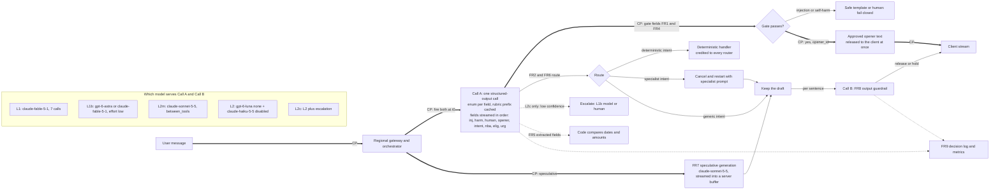

# LLM-way architecture (A1): L1, L1b, L2m, L2, L2c for the chat scenario

Status: Phase 2 design, agent A1 (advocate for the LLM way, written to be honest). Date 2026-10-11.
Inputs: PLAN v2.2 §2, `design/requirements.md`, `research/evidence-ledger.md`, `reviews/phase-1-factcheck-critic.md` (authoritative where it conflicts with a ledger row), and ledgers R1, R2 and R3.
Voice (V-S2S and V-casc) is covered in `design/voice-architecture.md`.

**Conventions**
- Every number cites a ledger ID or carries [Guessing a–b].
- All latency figures are Artificial Analysis (AA) **P50s at 10k input, probed from `us-central1`, with network included** (LLM-001). Our decision prompt is about 2.6k Claude tokens, so these figures are pessimistic for prefill.
- **No p95 exists for any LLM decision path** (LLM-018). Every p95 here is modelled as **p95 = m × p50, with m ∈ [1.5, 2.5] [Guessing]**, and M1 must sweep m.
- "×J1" always means the J1 batched decision call at $0.000084 per message (ECO-091), never Jev's FR8 calls (A2 models those).

## 0. Verdict in one screen

| Rung | Best realistic config (decisions) | Verdict |
|---|---|---|
| L1 | `claude-fable-5-1` at default effort, one call per decision | Anti-pattern; it exists only to reconcile the vendor's numbers. About 22 s per decision (LLM-010) and $0.23–0.37 for decisions alone (R3 BoE). Never a headline |
| L1b | `gpt-6-astra` or `claude-fable-5-1` at effort `low`, batched | About 3 s to the gate fields and 92–270× J1 on cost. Use it only as the **escalation target** of L2c, off the critical path |
| L2m | `claude-sonnet-5-5` with `thinking: {type: "between_tools"}`, batched | About 1.0 s to the gate fields and 16–19× J1 on cost. Worth it only when small-tier accuracy fails the golden set (multi-hop FR5) |
| L2 | `gpt-6-luna` (effort `none`, logprobs) as primary and `claude-haiku-5-5` (thinking `disabled`) as hedge; one batched call, rubric cached | **The fair baseline.** At price parity with J1 (0.92–1.08×, R3 BoE). **Fails NFR-1/4/6 on latency** (gate about 0.4–0.9 s median). Meets NFR-2 only with speculative generation plus the approved-opener pattern (§3.4) |
| L2c | L2, with confidence escalation to L1b or a human | Escalation dominates its cost and tail. Sound on Luna logprobs; weak on Claude (verbalized confidence only) |

**The LLM way's honest position:** it wins the System-2 half (FR7, multi-hop, multimodal, long history, EU residency) and reaches cost parity at the small tier. It loses the **critical-path decision latency**, especially the per-sentence FR8 (NFR-4, 150 ms), and the best mitigation hides that latency rather than removing it.

## 1. Rungs: exact configuration

| Rung | Decision model IDs (exact) | Reasoning setting (exact params) | Decision requests per chat message | Generation (FR7) |
|---|---|---|---|---|
| L1 | `claude-fable-5-1` (Fable 5.1 must keep 30-day retention, LLM-032) | Omit `thinking`; thinking is always on. Default effort `high` (LLM-010) | 7 call-A + 2 FR8 = 9 | `claude-fable-5-1` |
| L1b | `gpt-6-astra` (`reasoning.effort: "low"`; `none` → 400) or `claude-fable-5-1` (`output_config.effort: "low"`). `claude-opus-5-5` at `low` is cheaper but slower: 8.65 s (LLM-009) | Reasoning cannot be disabled on any frontier model (LLM-027), so "lowest effort" is the floor | 1 + 2 = 3 | Same frontier model |
| L2m | `claude-sonnet-5-5`. Alternatives: `gpt-6.1-sol` (no `none`/`minimal`, LLM-037), `gemini-3.8-flash` (low–high only, LLM-048) | Sonnet: `thinking: {type: "between_tools"}` at effort ≤ `high`, so no up-front thinking (LLM-027, ECO-010) | 3 | `claude-sonnet-5-5` |
| L2 | `gpt-6-luna` (primary) + `claude-haiku-5-5` (hedge/fallback) | Luna: `reasoning.effort: "none"` (ECO-020). Haiku: `thinking: {type: "disabled"}` + `output_config.effort: "low"`; disabled is allowed only at effort ≤ `high` (LLM-026) | 3 | `claude-sonnet-5-5`, streamed |
| L2c | L2, escalating to L1b (`claude-opus-5-5` or `gpt-6-astra` at `low`) or to a human | As L2; escalations as L1b | 3 (+4 if Claude k = 5) + e × 1 | `claude-sonnet-5-5` |

**Rejected for L2, with reasons (no strawman):** `gemini-3.5-flash-lite`.
- It cannot turn thinking off (`minimal` is the floor), and its first chunk takes 8.96 s at that default (LLM-016, LLM-048).
- 3.x models no longer return logprobs [Likely] (LLM-049).
- It costs 3× the small-tier input price (LLM-047).
- It guarantees only syntactically valid JSON (LLM-050).

**Do not use Claude on Bedrock for decisions:** it has no structured outputs (LLM-025).

## 2. Family diagram (critical path = thick `==>` edges labelled CP)

**Critical path:** gateway → Call A gate fields → opener released, with generation running speculatively in parallel. Without the opener (§3.4) the critical path becomes `max(gate, generation's first sentence) + FR8` (§4.1). The syntax was checked with `mermaid.parse` (mermaid 11.4.1).

## 3. Design choices shared by every LLM rung

### 3.1 Batching: one structured-output call with an enum per field
- **One call carries every pre-generation decision:**
  - FR1 × 4 (injection, self-harm, abuse, PII)
  - FR4
  - `opener_id`
  - FR2 (77 intents + `oos`)
  - FR6
  - FR5 extracted fields (purchase-date bucket, amount bucket, tier)
  - FR3 (score as the enum `"0"`–`"3"`)
- **Use `output_config.format`, not forced tool use.**
  - Opus 5.5, Sonnet 5.5 and Fable 5.1 reject forced `tool_choice` [claude-api reference; not in the ledger].
  - JSON outputs also avoid the 286–406-token tool-use system prompt (ECO-061).
- **Schema rules that work on both Claude and OpenAI:**
  - `additionalProperties: false` and every field required (LLM-041).
  - Only enums, with no numeric or length constraints; these return 400 on Claude (LLM-024).
  - At most 1,000 enum values on OpenAI (LLM-041).
  - Normalize enum casing on parse, because Claude does not guarantee it (LLM-024).
- **Field order is a latency feature.** The gate fields come first. The orchestrator parses the streamed partial JSON and acts on each field as soon as it closes. The gate is then ready after about 10 output tokens instead of 60. [Verify on each provider that the emitted key order follows the schema order.]
- **Codes are short and tokenizer-aware** (PLAN §6 LL3), so that on Luna the first token of a value identifies the option, which the logprob confidence needs (§5).
- **Changing the schema invalidates the prompt cache, and the first use of a new schema adds compile latency** (LLM-024, LLM-041). So pre-warm the cache on deploy (§8).

### 3.2 Prompt caching

| Provider | Minimum cacheable prefix | Read price | Counts toward the rate limit? | Consequence |
|---|---|---|---|---|
| Claude (all 5.x) | 512 tokens (LLM-028, ECO-009) | 0.1× Haiku; 0.05× Sonnet and Opus; 0.025× Fable (LLM-028) | **No:** cache reads are excluded from ITPM (LLM-029) | Caching raises capacity as well as cutting cost |
| OpenAI (GPT-5.6+) | 1,024 tokens (LLM-042) | 0.1×; 0.05× on Sol (LLM-042) | **Yes:** cached tokens count toward TPM (LLM-042) | Headroom must be computed on total input |
| Gemini 3.8 Flash / 3.1 Pro | 4,096 tokens (LLM-051) | 0.1× plus storage per MTok-hour (ECO-021, ECO-023) | Not stated | A rubric of about 2k tokens **will not cache** (ECO-025) |

**What is cached:** one frozen prefix per call type, ordered `system` → rubric → few-shot examples, with the cache breakpoint before the user turn. Everything volatile goes after the breakpoint: the message, the conversation snippet and any IDs.
- **Call A prefix:** about 2,210 Claude tokens, or 1,700 o200k tokens. This is the same 1,700-token rubric R3 used [Guessing, ECO-060], at the Claude tokenizer factor of 1.3 (ECO-007). It is well above both minimums.
- **Call B (FR8) prefix: the short-rubric problem.** An FR8 or single-decision rubric of about 340 tokens (the lab's rubric, `lab/LEARNING.md` [LAB, illustrative]) is **below Haiku 5.5's 512 minimum** and is silently not cached (ECO-009). The options, per FR8 call on `claude-haiku-5-5`:

| Option | $ per FR8 call | Note |
|---|---|---|
| Accept uncached (340 rubric + 150 dynamic tokens) | $0.000054 | Simplest. Uncached tokens count toward ITPM (LLM-029) |
| Reuse the 2,210-token call-A prefix | $0.000042 | One cache entry, but each sentence re-reads 2,210 tokens |
| **Pad a dedicated FR8 prefix to ≥ 520 tokens with useful policy examples (chosen)** | **$0.000025** | Cheapest. On OpenAI pad to ≥ 1,024 instead: $0.000030 |

(Arithmetic uses ECO-001 and ECO-013 prices; the 150-token dynamic part is [Guessing 100–250].)

**Cache operations:**
- The TTL is 5 minutes, refreshed on every hit (LLM-028), so at ≥ 1 msg/s the cache stays warm. Low-traffic, per-tenant rubrics pay repeated 1.25× writes (ECO-009).
- A cache-miss storm, for example after a prompt deploy, costs 3.2× (uncached Haiku $0.000290 vs cached $0.000091, R3 BoE). Cache writes also count toward ITPM (LLM-029).

### 3.3 Thinking and effort: what goes wrong at the default

| Model | Default | Required setting | If left at the default |
|---|---|---|---|
| `claude-haiku-5-5` | Thinking on (adaptive), effort `medium` (LLM-026) | `thinking: {type: "disabled"}` + `output_config.effort: "low"` (≤ `high`) | First answer chunk 9.72 s at `low` and 13.40 s at `medium` (LLM-003, LLM-004). Cost 2.27× J1 with 200 thinking tokens (R3 BoE) |
| `gpt-6-luna` | `medium` (LLM-037) | `reasoning.effort: "none"`. Logprobs and function calling work only at `none` (LLM-038, LLM-040) | No logprobs (§5), and reasoning latency of 2.83 s or more at `low` (LLM-012) |
| `claude-sonnet-5-5` | `high` | `between_tools` at effort ≤ `high` (LLM-027) | 11.87 s to the first chunk at `high` (LLM-008) |
| `claude-opus-5-5`, `claude-fable-5-1`, `gpt-6-astra`, `gpt-6.1-sol` | Thinking always on | Lowest effort only (LLM-027). This is why L1b means "lowest effort" | Not applicable |

**Startup probe:** reject the deploy if a call-A response contains a thinking block, or more than 2× the expected output tokens. The lab stub has a `claude_thinking_block` fault for this test (`lab/LEARNING.md`).

**Haiku trap:** with thinking off it "can skip a tool call it needs when you also request JSON output" (LLM-026). Call A therefore uses JSON outputs and no tools.

### 3.4 Speculative generation and the approved opener
- **At t0, fire Call A and FR7 generation in parallel.** Generation streams into a **server-side buffer**, never to the client. If the gate fails, generation is cancelled and discarded. If FR2 or FR6 route the message elsewhere, generation is cancelled or restarted.
- **The cost of speculation is real.** A discarded start costs about $0.0018: the Sonnet prefill ($0.0013 for 3,000 cached + 500 uncached tokens, R3 BoE) plus about 50 tokens decoded before the cancel. At a discard rate of [Guessing 10–30%] that adds **$0.00018–0.00054 per message, which exceeds the whole L2 decision bill**.
- **Approved-opener pattern.** Call A also picks `opener_id` from a pre-approved enum, for example "I can help with that refund." The opener needs no FR8 check, so it is released as soon as its field closes. While the user reads the opener, generation, FR8 and release of sentence 2 continue behind it. Sentence k+1 is checked while sentence k is read or played, so FR8 latency is hidden after the first sentence. The full argument is in the voice doc §5.
- **Fairness:** speculation and the opener pattern are **architecture-neutral** and must also be credited to J1 and J2. Jev needs them less, because its decisions arrive sooner (JEV-028, JEV-030, JEV-031).

### 3.5 Deterministic-handler routing
- Call A's FR2 and FR6 enums route `order_status`, `card_arrival` and similar intents to **deterministic code**, so no generation is needed. This is the pattern in JEV-060 and must be credited to every router architecture (Critic-2 fairness rule), the LLM router included.
- **FR5 split:** the LLM extracts enumerated fields, and code does the date and amount comparisons. That keeps eligibility auditable on both sides.
- The LLM way's extra option: on low extraction confidence it can send multi-hop policy reasoning to L1b/L2m.

### 3.6 Client settings on the real-time path
- **Override the SDK defaults.** The `anthropic` SDK defaults to a 10-minute timeout and 2 retries (`lab/LEARNING.md`). Use `client.with_options(timeout=…, max_retries=0)` per request.
- **No retry on 429/529.** The `retry-after` wait exceeds any real-time deadline (LLM-029). Instead, fire **one hedge** to the other L2 vendor after the observed p90, which adds about 10% to decision cost [Guessing 5–15%].
- **Circuit-break per provider** on 429, 529 and timeouts, then apply the fallback chain in §4.5.

## 4. Per-architecture delta tables

### 4.1 Per-hop latency (chat, US-West gateway; median, plus modelled p95 = 1.5–2.5× median [Guessing])

| Hop | L1 | L1b | L2m | L2 (Luna / Haiku) | L2c |
|---|---|---|---|---|---|
| Gateway → provider RTT | Included in the AA TTFT (LLM-001). Region add-ons: EU→US +126–154 ms (ECO-068, ECO-072); India→US +194–240 ms (ECO-066, ECO-071) | same | same | same; **EU in-region possible** at +~2 ms (§9) | same |
| Call A time to first answer token | 22.17 s (Fable `high`, LLM-010) | 2.69 s Astra / 2.84 s Fable `low` (LLM-014, LLM-010) | 0.88 s (Sonnet `low`, LLM-008; `between_tools` unmeasured) | 0.83 s (LLM-011) / 0.48 s (Haiku 4.5 proxy, LLM-007). Haiku 5.5 with thinking off is unmeasured (LLM-006) | as L2 |
| Decode to the gate fields (about 10 tokens [Guessing 6–15]) | about 0.2 s at 54 tok/s (LLM-010) | 0.19–0.24 s (42–53 tok/s) | 0.10 s (100 tok/s) | 0.08 s (126 tok/s) / 0.06–0.12 s (86.6–178 tok/s, LLM-007, LLM-003) | as L2 |
| **Gate ready (FR1, FR4), median** | ≈ 22.4 s | ≈ 2.9–3.0 s | ≈ 1.0 s | ≈ 0.9 s / 0.5–0.6 s. A 2.6k prompt vs AA's 10k → **[Guessing 0.4–0.9 s]** (LLM-083) | same, plus escalations |
| **Gate ready, modelled p95** | 34–56 s | 4.4–7.6 s | 1.5–2.5 s | 0.6–2.3 s | **4.8–5.4 s** when e ≥ 5% and the escalation blocks (L2 + L1b) |
| All fields (60 tokens), median | 22–31 s (LLM-010) | 4.0–4.1 s | 1.5 s | 1.3 s / 0.8–1.2 s | escalations add 4.0–4.1 s |
| FR8 per sentence (Call B ≈ TTFT + 10 tokens) | ≥ 22 s | about 3 s | about 1.0 s | **0.4–0.9 s [Guessing]** | as L2 |
| NFR-1 (p95 ≤ 300 ms) | Fail | Fail | Fail | **Fail.** Flips only if the gate median is ≤ 120–200 ms; no ledger row supports that, so P1 stands for L2 | Fail |
| NFR-4 (FR8 p95 ≤ 150 ms) | Fail | Fail | Fail | **Fail** (2.7–6× at the median) | Fail |
| NFR-2 chat TTFT with the opener (gate + opener field) | Fail | Fail (≈ 3 s) | ≈ 1.0 s median; fails at p95 | **≈ 0.5–0.9 s median; 0.8–2.3 s p95: marginal** | L2, unless escalation blocks |
| NFR-2 without the opener: max(gate, Sonnet TTFT 0.88 s + first sentence ≈ 0.15 s) + FR8 | Fail | Fail | ≈ 2 s | ≈ 1.4–1.9 s median: **fails** | Fail |

**Read-across:** the generation TTFT (0.48–0.88 s, LLM-007, LLM-008, LLM-011) is common to **every** architecture, J1 included. So NFR-2's p95 ≤ 1.0 s is at risk for all of them. That is a requirements-level finding, not an LLM-only one.

### 4.2 Token flow per chat message (Claude tokens, with o200k tokens in parentheses; tokenizer factor 1.3, ECO-007)

| Item | L1 | L1b | L2m | L2 | L2c |
|---|---|---|---|---|---|
| State / dynamic, uncached | 390 per call × 7 (re-sent each call) | 390 (300) | 390 (300) | 390 / (300) | 390 (300); × k if self-consistency |
| Rubric / static | 316–2,210 per call, **uncached** (R3 L1 assumption) | 2,210 (1,700), **cached read** | 2,210, cached | 2,210 / (1,700), cached | cached; the escalation call re-reads its own model's cache, because caches are model-scoped [claude-api reference] |
| FR8 prefix (cached) + dynamic, × 2 calls | Fable, uncached | 520 (1,024) + 150 | 520 + 150 | 520 / (1,024) + 150 | as L2 |
| Output | about 10 per call | 60 | 60 | 60 (R3 BoE) | 60, + about 30 for verbalized-confidence buckets on Claude [Guessing 20–40] |
| Thinking / reasoning (billed as output, ECO-010) | 500 per call (R3) | 300 call A (R3) + 100 per FR8 [Guessing 50–300] | 0 (Sonnet `between_tools`); Sol `low` unknown [Guessing 100–300] | **0** (`disabled` / `none`) | 0; 300 on escalation |
| Cached share of call-A input | 0% | 85% | 85% | 85% | 85% |
| Generation (FR7) | Fable: 3,000 cached + 500 uncached in, 250 out, + 500–2,000 thinking [Guessing] | frontier, + 100–300 thinking [Guessing] | Sonnet 5.5: 3,000 cached + 500 in / 250 out (R3) | same as L2m | same as L2m |

### 4.3 $ per message (list prices: ECO-001, ECO-004 to ECO-006, ECO-013 to ECO-015; R3 BoE token shape; FR8 = 2 calls per message [Guessing 1–4])

| $ per message | L1 | L1b | L2m | L2 | L2c (e = escalation rate [Guessing 5–30%]) |
|---|---|---|---|---|---|
| Call A | $0.22–0.36 (R3) | Opus 5.5 $0.0092; Fable $0.0225; Astra ≥ $0.0077, or $0.013–0.023 with 100–300 reasoning tokens (R3, ECO-020) | Sonnet $0.0016; Sol ≥ $0.00137 (R3) | **Luna $0.000077 / Haiku $0.000091** (R3) | base + e × $0.0092 (Opus 5.5 L1b) |
| FR8 (2 calls) | ≥ $0.014 | Opus $0.0058; Fable $0.0143; Astra $0.0061 | $0.0009 | $0.000060 / $0.000050 | as L2 |
| **Decisions only** | **$0.23–0.37** | **$0.014–0.037** | **$0.0024–0.0025** | **$0.000137 / $0.000141** | Luna logprobs $0.0006–0.0029; Haiku verbalized $0.0006–0.0029; Haiku k = 5: $0.0010–0.0033 |
| Call A × J1 ($0.000084, ECO-091) | 2,600–4,300× | 92–270× | 16–19× | **0.92 / 1.08×** | ≈ 7–35× |
| Generation (FR7) | $0.043–0.118 (Fable `high`) | Opus $0.0096–0.0136; Fable $0.023–0.033 | $0.0038 (R3) | $0.0038 (R3) | $0.0038 |
| Speculation waste (§3.4) | — | — | +$0.00018–0.00054 | +$0.00018–0.00054 | same |
| **Decisions + generation** | **$0.28–0.49** | **$0.025–0.029 (Opus); $0.060–0.070 (Fable)** | **$0.0063** | **$0.0039** (+ speculation) | **$0.0044–0.0071** |
| Decision share of the bill | 76–84% | 52–61% (Opus) | 40% | **3.6%** | 14–43% |

**Context:**
- The uncached small tier costs $0.00023–0.00029 for call A, 2.7–3.5× J1 (R3 BoE).
- With Haiku thinking left on (200 tokens), call A costs $0.000191, 2.3× J1 (R3 BoE).
- `inference_geo: "us"` multiplies the cost by 1.1 (ECO-011).
- Human escalation costs $8–23 per contact (ECO-077), which dwarfs all of the above: a 1-point change in automation is worth about 1,000× the decision bill (R3 bullet 7).

### 4.4 Rate-limit headroom at peak (limit ÷ demand; ≥ 1.5 required, requirements §5)

Peak load is 40.5, 405 and 2,025 msg/s for 1M, 10M and 50M messages/day (requirements §5). This design sends 3 decision requests per message: call A plus 2 FR8 calls.

| Rung / model / tier | 1M/day | 10M/day | 50M/day | Binding limit |
|---|---|---|---|---|
| L2 `gpt-6-luna`, Grow tier (30K RPM, 180M TPM; LLM-038) | **4.1×** | 0.41× | 0.08× | RPM. TPM headroom including cached tokens is 17× / 1.7× / 0.34× (LLM-042) |
| L2 `claude-haiku-5-5`, Scale tier (10K RPM, 10M ITPM, 2M OTPM; LLM-030) | 1.37× (below the 1.5 target) | 0.14× | 0.03× | RPM. ITPM 6.0× / 0.60× / 0.12× (cache reads excluded, LLM-029); OTPM 10× / 1.0× / 0.21× |
| Same two, at 1 request per message (requirements §5.2 basis) | Luna 12× / Haiku 4.1× | 1.2× / 0.41× | 0.25× / 0.08× | RPM |
| L2c on Claude with k = 5 self-consistency (7 requests per message) | **0.59×** | 0.06× | 0.01× | **Infeasible even at 1M/day** |
| L2c on Luna logprobs | as L2 Luna, + e × peak on the frontier tier | | | Frontier limits are not in the ledger |
| L2m, L1b, L1 (Sonnet, Opus, Fable, Sol, Astra) | Unknown: tier limits are not in the ledger | | | Assume Custom-tier negotiation at 10M+ [Guessing] |
| FR7 generation on `claude-sonnet-5-5` (**every architecture, J1 included**) | Not in the ledger | | | Symmetric: J1 needs it too |

**Mitigations:**
- Spread traffic across providers behind the Decision Service port: Claude API, Claude on Google Cloud (structured outputs supported, LLM-025) and OpenAI. Limits add up across providers.
- Batch FR8 per 2 sentences in chat.
- Negotiate Custom tiers.
- **Takeaway:** at 10M/day and above, every hosted option needs negotiated limits, Jev included (requirements §5.2).

### 4.5 Deadlines, retries, fallbacks, fail-open/closed (consistent with requirements §4.1)

| Item | L1 | L1b | L2m | L2 | L2c |
|---|---|---|---|---|---|
| Per-call deadline | Not usable in real time | Async only; escalation deadline 6 s [Guessing 4–8] | Gate 1.5 s [Guessing] | **Gate 0.9 s, all fields 1.5 s, FR8 1.0 s** [Guessing; reset from the shadow p95] | Escalation 6 s (blocking only for FR4/FR5, behind a "let me check" opener) |
| NFR-6 (250 ms per call) | **Infeasible for every LLM rung** (gate median ≥ 0.4 s, LLM-083). This is a documented deviation | | | | |
| Retry policy | 0 retries on 429/529/5xx; **1 hedge** to the other vendor after the p90; 1 retry only on a connection reset, and only if it fits the deadline | | | | |
| Fallback chain | L1b → L2 | → L2 | → L2 → C1 | Luna ⇄ Haiku hedge → C1a in-process for FR2, FR3, FR6 (about 1.5 ms [LAB, illustrative], `lab/results/c1_sweep.csv`) → §4.1 defaults | low confidence → L1b or a human; timeout → the L2 chain |

**LLM-specific triggers that count as "error" under §4.1:**
- `stop_reason: "refusal"`
- the OpenAI `refusal` field
- schema-invalid output
- `max_tokens` truncation
- an enum value outside the set

| Decision | Timeout / 429 / 529 / invalid output | Refusal | Low confidence (L2c) |
|---|---|---|---|
| FR1 injection, self-harm | **Fail closed** (safe template or human) | **Fail closed.** Treat a refusal on the input as a positive signal | Escalate, holding the reply |
| FR1 PII present | Fail open (redact downstream) | Fail open | Fail open |
| FR2 intent | C1a, then the generic LLM handler | C1a | Escalate or C1a |
| FR3 urgency | Fail open (default priority) | Fail open | Fail open |
| FR4 needs human | **Fail closed** (offer a human) | **Fail closed** | **Fail closed** |
| FR5 eligibility | **Fail closed** (no automatic refund) | **Fail closed** | Escalate to L1b (multi-hop), else human |
| FR6 next-best action | Fail open (default action) | Fail open | Fail open |
| FR8 output guardrail | **Fail closed** (hold the sentence, use a safe phrase) | **Fail closed** | **Fail closed** |

## 5. Confidence per rung: how it is obtained, ECE, and L2c thresholds

| Rung / model | Token logprobs? | Method | Cost and latency | Resolution |
|---|---|---|---|---|
| L1, L1b, L2m on Claude | **No** (LLM-021). The OpenAI-compatible layer silently returns empty `logprobs` (LLM-022) | Verbalized confidence as an enum bucket per field (`"50"…"99"`), or k samples at **temperature fixed at 1.0** (LLM-023) | Verbalized: about +30 output tokens. k-sampling: k× cost and k× RPM | Verbalized values cluster at 80–100% in multiples of 5 (LLM-073); k = 5 gives a grid of 0.2 |
| L1b `gpt-6-astra`, L2m `gpt-6.1-sol` | Likely **no**: logprobs appear to need effort `none`, which these models reject (LLM-027, LLM-040) [Likely] | Verbalized | As above | As above |
| L2m Gemini 3.x | Likely **no** (LLM-049) | Verbalized | — | — |
| **L2 `gpt-6-luna`, effort `none`** | **Yes:** `top_logprobs` 0–20 (LLM-039, LLM-040) | Read the top-20 at the first token of each enum value, renormalize over the valid options, and **report the captured mass**: the top-20 truncates 77 intents (LLM-039) | No extra calls | Continuous. [Unverified: whether logprobs are taken before or after the structured-output mask. Probe live] |
| L2 `claude-haiku-5-5` | No | Verbalized (default), or k = 5 only for FR1/FR4 | k = 5: 5× call A and 7 requests per message (§4.4) | Coarse |
| Cross-vendor | — | Luna vs Haiku disagreement on the same call A is an extra uncertainty signal and gives a diverse guardrail ensemble | 2× call A ($0.000168 vs J1's $0.000084, ECO-091) | Binary |

**How ECE is computed (NFR-8):**
1. Take a labelled golden set (§8) with separate calibration and test splits (PLAN §6 LL4).
2. For each decision field, take confidence = calibrated p_max (Luna), the vote fraction (k-sample) or verbalized/100.
3. Bin into **10 equal-mass bins** (the lab's convention). ECE = Σ_b (n_b/N)·|acc_b − conf_b|, with a bootstrap 95% CI.
4. Fit temperature scaling (logprobs, LLM-076) or isotonic regression (verbalized or vote scores) on the **calibration split only**. Report ECE before and after on the test split.
5. k-sample and verbalized scores have heavy ties, so use tie-aware binning and report the number of distinct values.
6. Compare **like-for-like**. Anand's pilot mixed verbalized LLM confidence with decision-model label probabilities, so its ECEs are not comparable (Critic-1 V16).

**What this means for the L2c thresholds:**
- Thresholds are set on the **risk–coverage curve** of the calibration split, to meet NFR-7: ≥ 97% accurate at ≥ 70% automation. Escalation rate e = 1 − coverage.
- **On Luna:** continuous calibrated scores → a smooth risk–coverage curve → the lowest e for a given error budget. RLHF logprobs are miscalibrated before recalibration (GPT-4: ECE 0.007 → 0.074 after RLHF, LLM-071), so labels are mandatory. This is the same "labels are needed" caveat that applies to Jev's thresholds (Critic-1 finding 6).
- **On Claude:**
  - Verbalized confidence has weak ranking; older-model AUROCs are 0.5–0.6 (LLM-073).
  - The flat top of the curve forces a higher e for the same error budget.
  - Since e × $0.0092 dominates L2c's cost (§4.3), **weak confidence turns directly into dollars and tail latency**.
  - k = 5 cut ECE by only about 24% in Xiong et al. (LLM-073), at 5× cost, and breaks capacity (§4.4).
- **Recommendation:** run L2c's confidence-gated fields (FR2, FR4, FR5) on `gpt-6-luna`, and keep Claude for FR1/FR8 ensemble diversity and for generation.
- Thresholds are versioned per (model ID, prompt hash, schema hash) and **recalibrated on every change** (NFR-8).

## 6. Failure modes

| Failure | Detection | Mitigation | Fail mode |
|---|---|---|---|
| `stop_reason: "refusal"` (HTTP 200). Haiku 5.5 has **no server-side fallback** (LLM-033); the OpenAI refusal field does not follow the schema (LLM-041) | Check `stop_reason` before parsing; refusal-rate metric by category | Guardrail paradox: harmful inputs are exactly what gets refused. Treat it as FR1-positive and re-ask the routing fields on the other vendor or C1a | §4.5 table |
| `max_tokens` truncation produces partial JSON (LLM-024, LLM-041) | `stop_reason: "max_tokens"`; schema-invalid | `max_tokens` at 4× the expected output [Guessing 3–5×]; use the gate fields if they are already closed | Missing fields → §4.1 |
| Unsupported schema features → 400 (LLM-024, LLM-041); Gemini guarantees only syntax (LLM-050) | CI lint against each provider's subset | Enums only; validate values on Gemini | Deploy blocked |
| First use of a schema compiles slowly; grammar cached 24 h (LLM-024) | Latency spike after deploy | Pre-warm after every deploy | — |
| 429 with `retry-after`; limits are token buckets (LLM-029) | 429 rate; headroom gauges from response headers | No retry; hedge to the other vendor; circuit breaker; Custom tier | §4.5 chain |
| 529 overloaded / 5xx | Error rate | Hedge; breaker; C1a | §4.5 chain |
| Regional or provider outage | Health checks | Active-active Luna + Haiku; Claude on Google Cloud as a third path (LLM-025) | §4.1 |
| Model or version drift (safety classifiers, infrastructure, aliases) | Daily golden canary; drift in the confidence histogram (PSI) | Pin exact IDs (`claude-haiku-5-5`, `gpt-6-luna`; pin an OpenAI dated snapshot if one is offered [not in the ledger]); recalibrate on change | — |
| Thinking accidentally on (default effort `medium`) | Startup probe; output-token alarm | §3.3 | 10–13 s latency (LLM-003, LLM-004) |
| Silent cache invalidation (any byte change in the prefix, or a schema change, LLM-024) | `cache_read_input_tokens` = 0 | Freeze the prefix; pre-warm | 3.2× cost (R3 BoE) |
| Tokenizer change (+30% on Claude 4.7+, ECO-007) | $ per message alarm | Re-baseline with `count_tokens` | — |
| Wrong valid option, the real residual risk (PLAN §0 truth 6) | Golden set; disagreement metrics | Calibrated thresholds; cross-vendor ensemble for FR1/FR8 | — |
| Run-to-run nondeterminism: T is fixed at 1.0 (LLM-023) | Flip rate over k repeats on the golden set | Thresholds account for flip rate | — |
| Option-order bias: 13–75% accuracy gap from reordering (LLM-075, LLM-074) | Offline permutation test (the prefix stays frozen in production) | PriDe-style debiasing (LLM-074) | — |
| Price or lifecycle change: Gemini 3.8 Flash doubles in price on 2027-01-01 (ECO-023); gemini-3.5-flash deprecated (LLM-053) | Price watch | Port lets the backend be swapped | — |

## 7. Observability (FR9, NFR-12)

- **Per decision call, log:**
  - provider, exact model ID, `usage.inference_geo`, request ID
  - prompt / schema / rubric hashes
  - TTFT, time-to-gate-fields and total latency
  - `stop_reason` and refusal category
  - schema-valid flag; whether a hedge fired; which fallback was used
  - input, cache-read, cache-write, output and thinking tokens; computed $
  - per-field confidence: p_max and captured mass (Luna), vote fraction or verbalized bucket; escalation flag
- **Dashboards:**
  - p50/p95/p99 per call type and region. These fill the p95 gap (LLM-018).
  - cache hit ratio
  - 429/529/refusal/invalid rates
  - headroom against each tier limit
  - escalation rate e
  - Luna–Haiku disagreement rate
  - confidence-histogram drift
  - $ per 1,000 messages split into decisions, generation, speculation waste and human review (NFR-9)
- **Alarms:** cache read = 0; thinking tokens > 0 on L2; any FR8 hold rate above the baseline.

## 8. Evaluation and rollout

| Stage | What | Exit criterion |
|---|---|---|
| Golden set | The **same** labelled set and rubrics as the J and neutral rungs, with slices: English, Hindi/code-mixed, injection, image attachment, history > 32k tokens, out-of-scope. Size [Guessing 2,000–5,000]; calibration and test splits | NFR-7 and NFR-8 met on the test split; safety recall ≥ 0.98; schema-valid-and-answered ≥ 99.5% [Guessing]; permutation and run-to-run flip rates reported |
| Shadow | Mirror production traffic to the candidate backend, which takes no action | The first real p95/p99 by region; disagreement with the incumbent within limits |
| Canary | 1% → 5% of traffic, with automatic rollback on p95, refusal rate, invalid rate or an FR8 hold-rate breach | No breach for 7 days [Guessing] |
| Ramp | 25% → 50% → 100% | Same metrics |
| Change control | Any change of model ID, prompt, schema or tokenizer counts as a new version: re-run the golden set, recalibrate thresholds, re-shadow | Thresholds re-signed |

## 9. Security, privacy, residency

| Risk | Design |
|---|---|
| **Prompt injection aimed at the LLM guardrail itself** | The user text is data inside a delimited field after the cached prefix. Call A has **no tools**, and every output is an enum, so injection can only flip an enum and cannot exfiltrate anything. Natural context additions flip 61–73% of correct decisions in decision models (JEV-106, Critic-1 new row); LLM-specific rates are unmeasured here, so assume similar exposure. **FR1 injection must never rest on one model**: use a diverse ensemble (Luna + Haiku + a C1b encoder), OR-combined, failing closed. Cisco found a fine-tuned 1B encoder beats a decision model at strict FPR (JEV-105, Critic-1 new row). Keep a red-team slice in the golden set |
| PII to a third party | Redact identifiers before Call A where the decision does not need them. Use DPAs. **ZDR:** Anthropic by arrangement; caching is ZDR-eligible; structured outputs are "qualified" because the schema is cached ≤ 24 h (LLM-032). **`claude-fable-5-1` requires 30-day retention, so L1 is incompatible with ZDR** (LLM-032). OpenAI: abuse logs ≤ 30 days; ZDR by approval (LLM-043); without ZDR the default cache retention is 24 h (ECO-017). Gemini API: no ZDR; Vertex via an exception (LLM-054) |
| **US residency** | Claude `inference_geo: "us"` at 1.1× (LLM-031, ECO-011); OpenAI US regional processing (LLM-043) |
| **EU residency (an LLM-way advantage)** | `claude-haiku-5-5` on Google Cloud in the EU multi-region (LLM-035) or OpenAI EU regional processing at +10% (LLM-043). Decisions then stay in-region (≈ 2 ms RTT, ECO-072) instead of crossing to the US (126–154 ms, ECO-068). Jev processes only in the US (JEV-015) |
| **India (DPDP)** | **No current Claude, GPT-6 or Gemini 3.8 model processes in India** (ECO-089). In-region options are older models: `gemini-2.5-flash` or `gemini-3.5-flash` (deprecated) on Vertex `asia-south1` (LLM-053); `gpt-4.1-mini` or `gpt-4o` on Azure South India Standard (LLM-046); Azure South India Regional Provisioned Managed for `gpt-5-mini`, `gpt-5.4-mini` and others, with a capacity commitment (ECO-089). Claude on Bedrock in Mumbai is Global-routing only, with no structured outputs (LLM-034, LLM-025). Otherwise, process in the US under a DPA and pay 194–240 ms per round trip (ECO-066, ECO-071) |

## 10. Where the LLM way genuinely wins, and where it is weak

| Wins | Evidence | Weak | Evidence |
|---|---|---|---|
| **FR7 generation:** the only option on every architecture | JEV-076 | **Decision-path latency.** Gate median 0.4–0.9 s vs Jev medians of 0.10–0.39 s; no p95 on either side | LLM-083; JEV-028, JEV-030, JEV-031; LLM-018 |
| **Multi-hop eligibility** and indirection in one call (L2m/L1b) | Jev's failure modes JEV-071, JEV-074 | **FR8 per sentence:** 0.4–0.9 s vs a 150 ms budget. Hidden by the opener and pipelining, but not removed | §4.1; voice doc §5 |
| **Long account history:** 1M context on Haiku 5.5 vs Jev's 32k state | LLM-036, JEV-007 (over 100K input the price rises to $0.50, ECO-002) | **Confidence on Claude:** no logprobs; verbalized scores overconfident; k-sampling k× | LLM-021, LLM-073 |
| **Multimodal attachments** (damaged-item photos) | Jev is text-only (PLAN §0). Note that L2d peers also take images: OpenAI Decisions, Clef, d1 (LLM-044, JEV-108, JEV-110) | **Cost at mid/frontier tiers:** 16–270× J1 | R3 BoE |
| **Non-English / code-mixed:** frontier LLMs are the default answer, but **no per-language accuracy is in the ledger for either side** | JEV-013 (Jev "handled but not equally well") | **Capacity:** Haiku Scale is already at 1.37× at 1M/day with 3 requests per message; k-sampling is infeasible | §4.4 |
| **EU in-region processing**; ZDR options; no new vendor in the stack (the generation vendor already holds the data) | LLM-035, LLM-043, LLM-032 | **Config traps:** thinking on by default; refusals with no fallback on Haiku; schema subsets; cache minimums | LLM-026, LLM-033, LLM-024, LLM-028 |
| **Explaining a decision** to the user or an auditor | Jev cannot explain (PLAN §0) | **Speculation cost:** latency fixes cost more than the small-tier decision bill | §3.4 |

## 11. Fairness checklist (self-assessed for Critic-2)

| Item | Status |
|---|---|
| Same decisions and rubrics | Yes: the same 7 decision points + FR8, and the same rubric text as the J questions where possible; the same golden set (§8) |
| Same region assumptions | Yes: US-West gateway by default, with EU and India add-ons from ECO-066 to ECO-072 |
| Caching wherever supported | Yes on Claude and OpenAI. **Not possible on Gemini 3.8 Flash / 3.1 Pro** (4,096 minimum, ECO-025). That is recorded, not hidden |
| Best realistic config per rung | Yes: thinking off or lowest effort; batched; JSON outputs; streamed gate fields |
| Deterministic-handler routing credited to all routers | Yes (§3.5) |
| Speculation and approved opener credited to all architectures | Yes (§3.4) |
| Known biases against LLMs in the Jev evidence | Default reasoning and uncached costs in vendor evals; 0% cache hits in Suraj's test; 16-way pool contention in the cookbook; 8 vs 4 in-flight requests at Vals (Critic-1 balance finding 5) |
| Steelman of the other side attached | Yes (§12) |

## 12. Steelman of the Jev way (the strongest honest case)

1. **It wins exactly the latency the LLM way cannot hide.**
   - Independent Jev medians are 0.10–0.39 s (JEV-028, JEV-030, JEV-031), against a modelled L2 gate of 0.4–0.9 s and L2 FR8 of 0.4–0.9 s.
   - The LLM way's best answer, speculation plus an approved opener, *hides* latency and pays for it: speculation waste exceeds the whole small-tier decision bill (§3.4).
   - In voice, the first-audio decision and every FR8 after a barge-in sit on the critical path, and a 100 ms decision there changes the product (voice doc §3).
2. **Fan-out is nearly free.**
   - Going from 1 to 64 questions moved Jev's median from 0.10 to 0.12 s (JEV-028).
   - An LLM's decode time grows with every field it must emit. The LLM way has to engineer field order and streaming partial JSON just to get the gate early.
   - Jev lets the designer ask more questions (the Jevons bet) without touching the latency budget.
3. **Native distributions on every answer, with no k× sampling and no logprob plumbing.**
   - Jev's ECE is 0.011 on claim verification (JEV-083) and 3.5% on BoolQ (JEV-084).
   - Claude cannot produce a probability at all (LLM-021), and Luna's top-20 cap truncates a 77-way distribution (LLM-039).
   - Calibration is task-dependent (ECE 0.108 on LegalBench, JEV-083), but Jev's numbers *exist* at cold start, whereas the Claude path is unmeasurable without k× cost.
4. **No configuration traps.** There is no thinking default that turns 0.5 s into 13 s (LLM-004), no refusal stop reason on harmful inputs (LLM-033), no schema subset (LLM-024), no cache minimum or TTL (LLM-028), and outputs restricted to the options. That is operational simplicity a platform team values.
5. **Price is flat without cache engineering.**
   - At the small tier it is parity (0.92–1.08×), but only *after* caching, explicit thinking-off and a padded prefix (R3 BoE).
   - Against the tiers that might be needed for accuracy, mid and frontier, Jev is 16–270× cheaper (R3 BoE).
   - Cold, low-volume or per-tenant rubrics never warm a 5-minute cache.
6. **Strong where guardrails live.**
   - Jev ties GPT-6 Astra, GPT-6.1 Sol and GPT-6 Luna on claim verification at about 1/498 of Astra's cost (JEV-083).
   - It scored a median AUROC of 0.886 as an alignment-failure detector (JEV-093).
   - It beat a Gemma 4 31B judge on 7 of 8 safety sets (JEV-105).
   - A *different model family* in the FR1/FR8 ensemble gives error diversity an all-LLM ensemble lacks (JEV-073, a CEO claim [vendor]).
7. **Real adoption.** About 1.03B decision requests per week on OpenRouter, about 70× the next decision model (JEV-107). Its operational behaviour is exercised at scale.
8. **The decision fits the shape of the work.** Most of FR1 to FR8 is System-1: bounded outputs on short state. Running them on a generator and then constraining its output is the long way round. OpenAI itself shipped a Decisions API claiming "about 10× faster than the Responses API" (LLM-044, a vendor claim).

**The limits of this steelman (stated so it stays honest):**
- Jev serves from the US only, with no SLA and a 4-week track record (JEV-015, JEV-016).
- It came last on LegalBench and on BANKING77 (JEV-083, JEV-087).
- JevOut-style context flips (JEV-106).
- It cannot do FR7 at all.
- The strongest Jev design is therefore **J2 plus an LLM for FR7**, i.e. a hybrid. This doc's L2 sits behind the same Decision Service port as the fallback.

## 13. Gaps M1 and Phase 3 must close

- Haiku 5.5 thinking-off TTFT (LLM-006) and any LLM p95 (LLM-018). Shadow traffic is the only real source.
- Whether Luna logprobs are reported before or after the structured-output mask, and whether the emitted key order follows the schema order.
- Rate limits for the Sonnet 5.5, Opus 5.5, Fable 5.1, GPT-6.1 Sol and GPT-6 Astra tiers.
- Per-language accuracy for current small-tier LLMs (LLM-082: none found).
- Sweeps: m ∈ [1.5, 2.5], e ∈ [5%, 30%], FR8 calls per message ∈ [1, 4], speculation discard rate ∈ [10%, 30%].
