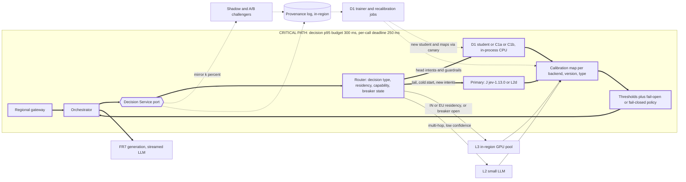

# Neutral architecture: the Decision Service port, L2d, L3, C1a/C1b and D1

Status: v1 (A3, neutral designer), Phase 2, 2026-10-11. Inputs: `PLAN.md` v2.2, `design/requirements.md` (FR/NFR IDs, peak msg/s, §4.1 fail modes, §5.3 client settings), the three ledgers, `reviews/phase-1-factcheck-critic.md` (authoritative over ledger rows; its proposed rows are cited as JEV-105 to JEV-110), and the lab results.

Tag rules:
- Every number cites a ledger ID (JEV-, LLM-, ECO-, LOC-) or carries [Guessing] with a range.
- **[LAB, illustrative]** marks numbers measured in this container on public data with CPU and tiny models. They never support a production claim (LL5). They appear only in §C.6 and §D.1–D.3.
- "Derived" means arithmetic on cited rows. Every derived number with a [Guessing] input is itself [Guessing].

## 0. Summary
1. **The headline idea is a typed Decision Service port.** Choice/Score/Noul goes in; the answer, calibrated probabilities, a port-defined confidence and provenance come out. Behind it sit swappable backends (J, L2d, L2, L3, C1a/C1b, D1). The port turns vendor choice into configuration. That matters because five hosted decision APIs appeared within four weeks of Jev (LLM-045, JEV-108–110), and the `/v1/systemone` schema already has several implementations (JEV-084, JEV-110).
2. **Where the neutral options beat both Jev and LLMs:**
   - in-region latency and residency, especially India;
   - capacity at 10M+ msgs/day;
   - cost per message for labelled, stable head intents (C1, D1);
   - safety classification at strict false-positive rates (C1b, JEV-105).
3. **Where they do not:**
   - zero-label cold start and fast taxonomy churn (Jev, L2d, LLM win);
   - generation, multi-hop reasoning and long state (LLM wins);
   - L3 **cost**. On on-demand GPUs, self-hosting costs *more* per message than Jev and the cheap L2d tier (Clef-flash, d1, Microsoft-Decision-1) at every volume in §C.3. It undercuts only OpenAI Decisions and Clef, and only at ≥ 10M/day [Guessing]. L3 is a residency, latency and control play, not a cost play.
4. **L2d is Jev's real peer group, and it changes the vendor-risk story more than the price story.** OpenAI Decisions adds EU residency, ZDR/HIPAA and images, at 2.4× Jev's price (ECO-091). Clef-flash is cheaper (0.90×) and has open weights (JEV-108). Rankings invert between JevBench and BANKING77 (§B.2), so pick backends on our own golden set through the port.
5. **D1 is our own pattern; it has no vendor precedent (JEV-064).** On token cost alone it breaks even at about 2.6–13M msgs/day [Guessing]. The real levers are automation quality (ECO-077) and capacity relief for the hosted primary (§E.4).

## A. The Decision Service port

### A.1 Typed interface (in-process library plus config; not an extra network hop on the critical path)
```ts
type Kind = "choice" | "score" | "noul";
interface Question { id: string; kind: Kind; instructions: string; criteria?: string;
  options?: { id: string; description?: string }[];   // choice; capability-checked (J max 255, JEV-008)
  levels?: number; }                                   // score levels (J: 2–10)
interface DecisionRequest {
  decision_type: string;                 // routing key, e.g. "intent.route@v3"
  state: string | object | string[];     // text; attachments only to image-capable backends
  attachments?: { uri: string; mime: string }[];
  questions: Question[];                 // questions routed to the same backend share one call (fan-out)
  ctx: { request_id: string; conversation_id: string; gateway_region: "us-west"|"us-east"|"eu"|"in";
         residency: "any"|"us"|"eu"|"in"; pii: boolean; deadline_ms: number; experiment?: string };
}
interface Answer { question_id: string; kind: Kind;
  value: string | number | boolean;      // option id | E[level] | (p_yes >= tau)
  probs_raw: Record<string, number>;     // as returned or scored
  probs: Record<string, number>;         // after the calibration map (A.5)
  confidence: number;                    // PORT-defined: calibrated p_max; max(p, 1-p) for noul
  margin: number;                        // p1 - p2 (calibrated)
  abstain: boolean; }                    // below this decision type's threshold -> escalate
interface DecisionResponse { answers: Answer[];
  status: "ok"|"fallback"|"degraded"|"failed_open"|"failed_closed"; provenance: Provenance; }
```
Design rules:
- **Confidence is defined by the port, never by the vendor.** Jev's `confidence` is a dispersion statistic, not P(correct) (JEV-055, JEV-058). Claude returns no probabilities at all (LLM-021). Thresholds therefore live in calibrated-probability space, so swapping a backend does not change what a threshold means.
- **Capability descriptors gate routing:** modality, option cap, context, languages, regions, ZDR, probability type, price, limits.
- The lab's `DecisionBackend` protocol (`lab/jevlab/types.py`: `probe` / `predict` / optional `fit`) is a working seed of this port. Every backend must pass a capability probe that fails loudly (LL2).

### A.2 Backends behind the port
| ID | Exact model / endpoint | Input | Limits | Probabilities | Processing regions | $/msg at 2,000 tok |
|---|---|---|---|---|---|---|
| J | `jev-1.13.0` via `POST /v1/systemone`; pin it, never `jev-latest` (JEV-001, JEV-002) | text only (JEV-012) | 255 options; 64K request / 32K state (JEV-007, JEV-008) | per option / level; Noul p_yes (JEV-011) | US only (JEV-015, JEV-018) | $0.000084 (ECO-091) |
| L2d-OAI | `gpt-6-luna` via `POST /v1/decisions`, public beta (LLM-044, LLM-045) | text + images (≤128 parts, LLM-045) | option cap not stated (LLM-044) | probabilities + `confidence` (LLM-044) | US, EU (LLM-044) | $0.00020 (ECO-091) |
| L2d-Cf | `@cf/cloudflare/clef-flash` (9B); `@cf/cloudflare/clef` (27B) (LLM-085) | text + ≤4 images (LLM-085) | context 24,576 / 65,536 (ECO-086) | every allowed option (LLM-085) | "Cloudflare-hosted", region unstated; India unverified (LLM-090) | $0.000076 / $0.00048 (ECO-091) |
| L2d-MS | `microsoft/microsoft-decision-1` (Foundry, OpenRouter) (LLM-086) | text; images not stated | 32,768 (JEV-109) | per option, vendor claim (LLM-087) | not stated (LLM-086) | $0.000084 (ECO-091) |
| L2d-Lq | `liquid/d1` (OpenRouter) or `d1` (Liquid API) (LLM-088) | text + images on Liquid API; text only on OpenRouter/Vercel (LLM-088) | 65,536 (JEV-110) | typed answers, `/v1/systemone` schema (JEV-110) | not stated (LLM-088) | $0.000080 (ECO-091), **but** "each question billed as a separate prompt" (LLM-088); up to about 7× if the state is re-billed per question [Guessing 1–7×] |
| L2 | `claude-haiku-5-5` (thinking disabled) / `gpt-6-luna` (effort `none`) | text + images | — | Claude: none, so verbalized or k-sample (LLM-021); Luna: top-20 logprobs, likely only at `none` (LLM-039, LLM-040) | Claude global/US (ECO-011); OpenAI US/EU/UAE (LLM-043) | $0.000091 / $0.000077 cached (R3 BoE) |
| L3 | self-hosted Clef-flash open weights, Qwen3.5-9B, or Kev 4B on vLLM/SGLang (§C.1) | text (+ images with Clef weights) | ours to set | full distribution from logits | any region we deploy | fleet-dependent (§C.3) |
| C1a | TF-IDF or static embeddings + logistic regression | text | fixed label set | full softmax | any | about $1×10⁻⁶ (ECO-082) [Guessing] |
| C1b | fine-tuned encoder (DistilBERT / BERT / about 1B class) | text | fixed label set | full softmax | any | about $1×10⁻⁶–1×10⁻⁵ (ECO-082; §D.5) [Guessing] |

### A.3 Routing policy per decision type (defaults; thresholds τ are fitted per type on the golden set to meet NFR-7)
| Decision type (FR) | Kind | Primary (US gateway) | EU / India override | Fallback chain | On failure (req §4.1) | Why |
|---|---|---|---|---|---|---|
| `guard.injection`, `guard.selfharm` (FR1) | Noul | **Ensemble:** C1b ∥ J (or L2d). Either one flagging means block | C1b ∥ L3 | survivor alone at a stricter τ, then a safe template | **closed** | Never a single decision model: JevOut flips 61–73% (JEV-106); adversarial content "can move the answer" (JEV-073); C1b wins at strict FPR (JEV-105) |
| `guard.pii` (FR1) | Noul | C1b | C1b in-region | redact downstream | open | Cheap, local, no third-party PII exposure (NFR-10) |
| `intent.route` (FR2) | Choice | D1 student if calibrated p_max ≥ τ_head; else J | student, else L3 | L2d-OAI, then C1 argmax if ≥ τ_fb, then generic LLM handler | open, to the generic handler | Head on CPU, tail on a zero-shot model (§E) |
| `urgency.score` (FR3) | Score 0–3 | batched into the FR2 backend call | same | default priority | open | Off the critical path |
| `needs_human` (FR4) | Noul | batched with FR2 on J/L2d (fan-out, flat latency, JEV-028) | L3 | L2d, then C1b | **closed** (offer a human) | Asymmetric error cost (Q9) |
| `policy.extract` (FR5) | Choice over enums + code | J/L2d; images go to L2d-OAI or Clef | L3 (Clef weights for images) | L2 for multi-hop | **closed** | Dates and amounts in code (JEV-069, JEV-070) |
| `nba.choice` (FR6) | Choice | batched with FR2 | same | C1, then the default action | open | — |
| `guard.output` per sentence (FR8) | Noul × 3 | C1b in-process, plus J/L2d in parallel | C1b ∥ L3 | survivor at a stricter τ | **closed** (hold the sentence) | 150 ms budget (NFR-4) |

Deterministic handlers (e.g. `order_status` routed straight to code, JEV-060) sit **after** the router for every backend, so every router architecture gets that credit (§G item 4).

### A.4 A/B testing and shadowing
| Mode | Traffic | On the critical path? | Cost | Rules |
|---|---|---|---|---|
| Offline replay | golden set + logged states, all backends | no | backend price × replay size | PII is replayed only to backends that meet `ctx.residency` |
| Shadow | mirror k% async after the primary returns [Guessing k = 1–10%] | no | k% × backend price | **Separate API keys**, so shadows never eat the primary's rate limits (JEV-005/006). Residency applies to shadows too |
| Canary | 1–5% of one decision type [Guessing] | yes | as primary | Needs the challenger's own calibration map first. Auto-rollback on a breaker trip or a quality SLO breach |
| A/B | randomised **by conversation**, not by message | yes | as primary | Metric: automation at a fixed error rate, escalation rate (ECO-077), latency p95. Size by power analysis |

### A.5 Per-backend calibration maps (key = backend × pinned version × decision type; refit on every version change, NFR-8)
| Backend | Native signal | Map | Evidence that a map is needed |
|---|---|---|---|
| J | option probabilities | temperature scaling (Choice/Score); Platt or isotonic (Noul) | ECE 0.011 on claims vs 0.108 on LegalBench (JEV-083); 0.138 on BANKING77 (JEV-087). Does not transfer across tasks |
| L2d-OAI | probabilities | temperature scaling | "materially overconfident" on BANKING77 (Critic-1, LLM-044) |
| L2d-Cf / MS / Lq | probabilities | temperature scaling | MS-D1 Calibration 84.40 vs Jev 90.6 (JEV-109); vendor calibration claims are [Guessing] (LLM-087) |
| L2 Claude | verbalized 0–100, or k samples | isotonic | Verbalized confidence clusters at 80–100%; k = 5 cuts ECE only about 24% at 5× cost (LLM-073) |
| L2 Luna | top-20 logprobs (captured mass logged) | temperature scaling | RLHF hurts calibration: ECE 0.007 → 0.074 (LLM-071) |
| L3, C1a, C1b | full softmax | temperature scaling (LLM-076) | C1a raw ECE 0.06–0.33 before scaling (§D.2) |

The caveat applies to every family: maps need labels. Jev's "no labels" advantage is a cold-start advantage only (LLM-076, JEV-058).

### A.6 Deadlines, retries, hedging, fallback chains and circuit breakers
- **Deadline:** 250 ms per call (NFR-6), propagated as `ctx.deadline_ms`.
- **Chain rule:** each fallback step runs only if the remaining deadline ≥ that backend's p50 × 1.5 [Guessing 1.2–2×]. The last element is always local (C1) or a static fail-open/closed policy.
- **Retries:** at most 1, owned by the port. Vendor SDK retries are off: Jev `timeout=0.25`, `max_retries=0`, overriding the 10 s / 2 retries / 30 s defaults (JEV-098, JEV-099).
- **Hedging:** send to the next backend in the chain after the primary's p90 (req §5.3) and cancel the loser [Guessing ≤ 10% extra calls].
- **Circuit breaker** per backend × region × decision type: opens when timeouts + 5xx + 429/529 ≥ 5% over 30 s, or when p95 > deadline in 3 consecutive 10 s windows. Half-open with 1% probes after 30 s [Guessing all thresholds ±2×]. A 529 means the vendor itself is overloaded (JEV-102), so it opens the breaker immediately; no per-account limit increase fixes it.

### A.7 Provenance log (FR9, NFR-12; append-only, stored in-region)
| Field | Example | Used for |
|---|---|---|
| `request_id`, `conversation_id`, `decision_type`, `routing_rule@ver` | `intent.route@v3`, `rule 17@2026-10-11` | audit; A/B attribution |
| `backend`, `model_id` (pinned), `weights_sha` / `api_version`, `region` | `J`, `jev-1.13.0`, `us-west-2` | version drift; recalibration triggers |
| `probs_raw`, `probs`, `confidence`, `margin`, `calibration_map@ver`, `abstain` | — | ECE drift dashboards; risk–coverage |
| `chain_path`, `status`, `breaker_state`, `hedged`, `retries` | `student→J(timeout)→L2d-OAI` | reliability SLOs |
| `latency_ms` per hop, `tokens_in`, `usd`, `cache_hit` | — | NFR-9 cost per 1,000 messages |
| `shadow[]` (backend, answer, probs), later `outcome` / `human_label` | — | D1 training set; recalibration; A/B |
| `state_ref` (pointer, not raw text) + retention class | — | PII minimisation (NFR-10) |

### A.8 Neutral family diagram (critical path = thick arrows and the bold box; NFR-1 clock runs from gateway accept until on-path decisions are available)

This is the "neutral" family diagram required by the Phase 0 modification. Per-architecture detail is in §F.

### A.9 Why the port is the build-vs-buy hedge
| Pressure | Evidence | What the port does |
|---|---|---|
| The category is commoditising | 5 hosted decision APIs at $0.038–0.24/MTok within 4 weeks (ECO-085–088); the shared `/v1/systemone` schema (JEV-110); an open API-compatible re-implementation (JEV-084); open weights (JEV-108) | Each new adapter is a schema mapping [Guessing 2–5 engineer-days each] |
| Vendor risk | Jev: 4 weeks old; no SLA (JEV-016); 99.838% is operator-reported (JEV-017, Critic-1); US only (JEV-015); dynamic limits (JEV-005); price possibly subsidised (PLAN §4: model it at 1×/3×/10×); no customer fine-tuning (JEV-014) | Fallback chains; a second vendor ready behind a config switch |
| Quality depends on the task | Rankings invert between JevBench and BANKING77 (§B.2) | Offline replay + shadow on *our* golden set picks the backend per decision type |
| Scale and residency | Every hosted option needs negotiated limits at ≥10M/day (req §5.2); India needs in-region processing (§C.5) | Moving a decision type to L3/C1/D1 is a routing change, not a rewrite |
| Cost of the hedge | Port + router + calibration store + log [Guessing 4–8 engineer-weeks]; ≤ 1 ms in-process overhead [Guessing 0.1–1 ms] | **Buy now** (hosted, no infrastructure); keep the **option to build** (L3/D1) when volume, residency or vendor terms demand it |

What the port does **not** hedge:
- semantic differences: non-complementary Noul negations (JEV-011), option caps, Score levels;
- rubric wording tuned to one model;
- the latency of the slowest backend in a chain.

## B. L2d: hosted decision-model APIs (Jev's direct peers)

### B.1 Capabilities and price
| Product | Images | Residency / India | ZDR | Probabilities | Price ($/MTok input; output free) | Weights |
|---|---|---|---|---|---|---|
| OpenAI Decisions `gpt-6-luna` | yes (LLM-044) | US, EU; India none (LLM-043) | ZDR + HIPAA for eligible customers (LLM-044) | yes + confidence; no calibration claim (LLM-044) | 0.10, no cache discount (ECO-085) | closed |
| Clef-flash `@cf/cloudflare/clef-flash` | ≤4 per request (LLM-085) | unstated; India unverified (LLM-090) | not stated | every option (LLM-085) | **0.038** (ECO-086) | **open** (post-trained Qwen3.5-9B, JEV-108) |
| Clef `@cf/cloudflare/clef` | ≤4 (LLM-085) | as Clef-flash | not stated | every option | 0.24 (ECO-086) | **open** (post-trained Qwen3.8-27B, JEV-108) |
| Microsoft-Decision-1 | not stated | not stated; India unverified (LLM-086) | not mentioned (LLM-086) | vendor claims calibrated (LLM-087, [Guessing]) | 0.042 (ECO-087) | base Qwen3.5-9B open; post-train not stated as open (ECO-087) |
| Liquid d1 | Liquid API yes; OpenRouter/Vercel text only (LLM-088) | not stated | not stated | typed answers (JEV-110) | 0.04; each question billed separately (LLM-088) | closed; "planned for upcoming models" (LLM-088) |
| *Reference: Jev* `jev-1.13.0` | no (JEV-012) | US only (JEV-015) | on request (JEV-015) | yes (JEV-011) | 0.042 (JEV-003) | closed |

Per message at 2,000 tokens (ECO-091): Clef-flash 0.90×, d1 0.95×, MS-D1 1.00×, OpenAI Decisions 2.38×, Clef 5.71× Jev. These ratios are approximate because the tokenizers differ.

### B.2 Quality and latency evidence (independent; probe location unstated in every source; medians only, no p95 anywhere)
| System | JevBench Capability (JEV-088, JEV-109, Critic-1 V25) | BANKING77 pilot, n = 77 (JEV-087 as corrected by Critic-1 V16) | Median latency |
|---|---|---|---|
| Jev `jev-1.13.0` | **77.1** (Calibration 90.6) | 75.3%, last of 17 | 0.39 s (JEV-030); 0.24 s (JEV-031) |
| Microsoft-Decision-1 | 70.78 (Calibration 84.40) | — | 459 ms native (JEV-109); 0.22 s P50 via OpenRouter (ECO-087) |
| OpenAI Decisions | 68.8 (preliminary, 300 public items) | 79.2% | **0.31 s in the same harness as Jev's 0.39 s** (JEV-087) |
| Clef-flash / Clef | — | **94.8% / 96.1%** | 0.49 s / 0.75 s (JEV-087) |
| Liquid d1 | — | 88.3% | vendor says 200–300 ms [Guessing] (LLM-089) |
| Open-weight Quyet-1.0-Large (self-hosted) | 81.7 (JEV-088) | — | 0.38 s, assumed adjustment (JEV-088) |

- **Adoption:** Jev carries 1.03B requests a week on OpenRouter, against 14.5M for the next decision model (JEV-107). That is real operational maturity.
- **Rankings invert.** On JevBench (1,500 items) the hosted order is Jev > Microsoft-Decision-1 > OpenAI Decisions. On the 77-case BANKING77 pilot, Clef, Clef-flash and d1 lead and Jev is last. Neither benchmark is our task.

### B.3 Design implications
- **L2d does not solve P1-IN.** No L2d product has verified Indian processing (LLM-043, LLM-090). Only OpenAI Decisions adds EU.
- **Latency:** only two L2d medians fall below Jev's 0.39 s: OpenAI Decisions at 0.31 s (JEV-087) and Microsoft-Decision-1 at 0.22 s via OpenRouter (ECO-087, probe unknown). Clef and Clef-flash (0.49–0.75 s) and Microsoft-Decision-1 native (459 ms) already miss a 300 ms p95 at the median.
- **L2d is the natural second vendor in Jev's fallback chain** (same primitives). OpenAI Decisions also covers the image cases (FR5 damaged-item photos) that Jev cannot take (JEV-012).
- **Clef's open weights** are the bridge from L2d to L3: the same model hosted today and self-hosted in-region tomorrow, behind the same port. Licence and serving throughput are unchecked (ECO-090).
- **Risks:** every L2d product is ≤ 4 weeks old; OpenAI Decisions is a public beta (LLM-045); no rate limits are published (R2 matrix (e)); and d1's per-question billing needs a token probe before any cost claim.

## C. L3: self-hosted small open-weight LLM or open decision model, in-region

### C.1 Candidates (licences and self-hosted throughput are unchecked: OPEN, ECO-090)
| Candidate | Size | Evidence |
|---|---|---|
| Clef-flash open weights | 9B (Qwen3.5-9B post-train) | 94.8% on BANKING77 when hosted (JEV-087); BF16 weights about 18 GB, fit a 24 GB L4/A10G (ECO-090) |
| Clef open weights | 27B | 96.1% hosted (JEV-087); needs FP8 on an L40S 48 GB or an H100 (ECO-090) |
| Qwen3.5-9B base + our scoring head | 9B | base of Microsoft-Decision-1 (JEV-109) |
| Kev 4B | 4B (Qwen3.5) | 87.0% on BANKING77 (JEV-087); open weights (JEV-089) |
| OpenJev on Qwen3.6-35B-A3B (SGLang) | 35B MoE | implements Jev's `/v1/systemone` API. BoolQ 89.45%, ECE 4.64% vs real Jev 91.56%, ECE 3.53% (JEV-084) |
| Generic ≤ 9B instruct LLM, zero-shot | 0.1–9B | best Banking77 0.708 and CLINC150 0.836 with full label lists (LLM-081). Weaker than purpose-built decision models |

### C.2 Mechanism: option scoring in one forward pass
1. **Prompt layout:** `[rubric + question text]` (prefix-cached in KV) + `[state]` (uncached) + one answer slot per question.
2. **Read the logits** of single-token option codes, or score full option sequences by teacher forcing. Softmax over the options gives a full distribution, with no free text and no hallucinated labels.
3. **Engineering traps** (lab-verified mechanics, transferable):
   - shared first tokens between options (LOC-023);
   - the top-20 logprob cap through OpenAI-compatible servers (LOC-002, LLM-039); score in-process for more than 20 options;
   - JSON-mode logprobs are pre-constraint (LOC-003, LOC-011);
   - position bias with letter codes in small models (LOC-027);
   - prefill grows with state size (LOC-028).
4. **Cost driver:** prefix caching is what makes L3 cheap (ECO-053). Tokens per message are 1,700 cached + about 300 dynamic (R3 BoE), plus answer slots [Guessing about 400 uncached in total, range 300–1,000]. There are 0 decode tokens.

### C.3 GPU sizing: N+1 per region, 3 regions (US 50% / EU 25% / India 25% of traffic [Guessing]), sized at 1.5× regional peak (req §5 headroom rule)
Throughput per GPU for a 9B scorer, one batched 7-question call per message:
- **H100, "conservative":** 19 msg/s. This is ECO-051's 1,024-in / 30-out rate, so it overstates the work per message.
- **H100, "planning":** 60 msg/s [Guessing 40–110]. Arithmetic: 2 × 9e9 FLOP × about 400 uncached tokens ≈ 7 TFLOP per message, at 30–40% of H100 dense BF16 peak.
- **L4:** 8 msg/s [Guessing 4–15]. There is no L4 serving benchmark in the ledger (R3 gap).

Prices per GPU-hour:
- H100: $6.88 US / $8.256 Mumbai (ECO-042); $9.08 EU, using Azure westeurope H100 NVL (ECO-046).
- L4: $0.8048 US / $0.9664 Mumbai (ECO-039). EU is priced at the US rate [Guessing +0–20%].
- 730 h per month.

| Volume (peak msg/s, req §5) | H100 planning: GPUs US/EU/IN → $/month → $/msg | H100 conservative: GPUs → $/month → $/msg | L4 planning: GPUs → $/month → $/msg | Hosted reference, $/month (ECO-091; Jev at 2,000 / 1,200 tok) |
|---|---|---|---|---|
| 1M/day (40.5) | 2/2/2 = 6 → $35.4K → $0.00116 | 7 → $40.4K → $0.00133 | 11 → $6.8K → $0.00022 | Jev $2.6K / $1.5K; Clef-flash $2.3K; OpenAI Decisions $6.1K |
| 10M/day (405) | 7/4/4 = 15 → $85.8K → $0.00028 | 35 → $199K → $0.00066 | 79 → $48.8K → $0.00016 | Jev $25.6K / $15.3K; Clef-flash $23.1K; OpenAI Decisions $60.8K |
| 50M/day (2,025) | 27/14/14 = 55 → $313K → $0.00021 | 163 → $926K → $0.00061 | 383 → $236K → $0.00016 | Jev $128K / $77K; Clef-flash $116K; OpenAI Decisions $304K |

All fleet figures are derived and [Guessing].

- **At the optimistic end** (110 msg/s per H100), 50M/day needs 31 H100s, about $177K/month or $0.000116/msg. That is still about 1.4× Jev at 2,000 tokens.
- **Discounts:** neocloud prices (RunPod L4 $0.59 −27%, H100 $2.89 −58%; ECO-048, ECO-049; no India region) or a 1-year commitment (GCP L4 −37%, ECO-044) cut these figures. Even then, rough parity with Jev appears only at ≥ 10M/day.
- **Bill share:** L3 adds 4–35% on top of the $0.0038/msg generation bill (R3 BoE).
- **Latency caveat [Guessing]:** an L4 running a 9B model at BF16 spends about 90–250 ms on ~400 tokens of prefill. That eats the 250 ms deadline. On L4 use FP8 or a 4B model (Kev 4B), or use H100/L40S.

### C.4 Cold start and autoscaling
- **A new GPU replica cold-starts in 3–12 min [Guessing].** That is instance boot + image pull + loading about 18 GB of weights (ECO-090). Scale-out therefore cannot absorb a burst.
- **Policy:**
  - keep ≥ 2 warm replicas per region (N+1);
  - schedule-based scaling for the diurnal curve;
  - reactive scaling on queue depth and TTFT, not GPU utilisation;
  - beyond capacity, the port spills to hosted L2d/Jev where residency allows, otherwise to C1, otherwise to the §4.1 fail policy.
- **Version rollouts:** pin weights by SHA, no `trust_remote_code` (LL6). Blue/green per region; recalibrate before canary (NFR-8).

### C.5 The India story (P1-IN; Mumbai gateway, decision p95 ≤ 300 ms)
| Option | Network | Service (median) | Verdict |
|---|---|---|---|
| Jev (US only) | 194–240 ms P50 to US-West (ECO-066, ECO-071) | 0.10–0.39 s (JEV-028, JEV-030, JEV-031) | **Fails** (0.29–0.63 s at the median) |
| OpenAI Decisions (US/EU) | to US-East 189–201 ms (ECO-067, ECO-071); EU not in the ledger [Guessing 110–150 ms] | 0.31 s (JEV-087) | **Fails** |
| In-India hosted LLM: Vertex `asia-south1` `gemini-2.5-flash`; Azure South India `gpt-4.1-mini` / `gpt-4o` (ECO-089) | 1–2 ms (ECO-073) | 0.4–1.0 s p50 proxy (LLM-083) | **Fails** for decisions; good for in-region **generation** |
| Clef on Workers AI | India unverified (LLM-090) | 0.49–0.75 s (JEV-087) | Unknown; needs a live probe |
| **L3 in Mumbai** (Clef-flash weights or Kev 4B; `ap-south-1`) | 1–2 ms (ECO-073) | 30–100 ms on H100 [Guessing; anchors: ECO-051 TTFT 92.74 ms for 1,024 uncached tokens; LLM-081 7B 55 ms per sample] | **Passes** [Guessing]; Mumbai GPUs cost +20% (ECO-039) |
| **C1 / D1 in Mumbai** | 0 (in-process) | ms (ECO-055) | **Passes**; Mumbai Arm CPU is *cheaper* than the US (ECO-043) |

India DPDP and Q8 ("PII must not leave the region unless covered by a DPA") point the same way. **Only self-hosted options are verified in-region decision paths for India.**

### C.6 Lab illustration (Hands-on lab context only; [LAB, illustrative], not production)
Setup: Qwen2.5-0.5B-Instruct Q4_K_M on 4 vCPUs, CLINC150 banking15 + out-of-scope, n_test = 240 (LOC-025 to LOC-028).
- **Accuracy:** JSON-schema 0.517–0.533; full-sequence scoring 0.404; letter codes 0.096–0.117 with a flip rate of 0.92–0.93 [LAB, illustrative].
- **Latency:** warm p50 0.087–0.70 s; Ollama cold start after unload 2.5–2.7 s [LAB, illustrative].
- **Agreement:** the server top-20 path matches the in-process exact scorer (argmax 0.958, mean |dp| 0.033) [LAB, illustrative]. The mechanics work.
- **What it means:** a 0.5B model is not a credible L3. Production L3 numbers come only from §C.3 and the ledger.

## D. C1a (measured here) and C1b (literature only)

### D.1 C1a accuracy vs labels per class (`lab/results/c1_sweep.csv`; 16 labels; test 240, calibration 160; bootstrap 95% CI) [LAB, illustrative]
Cells show accuracy [95% CI] · ECE before → after temperature scaling.

| Task · featuriser | N = 10 | N = 50 | N = 200 (capped at the class pool) |
|---|---|---|---|
| CLINC150 banking15+oos (P3 split) · TF-IDF + LR | 0.846 [0.800–0.892] · 0.275 → 0.053 | 0.908 [0.867–0.946] · 0.122 → 0.022 | 0.938 [0.904–0.967] · 0.091 → 0.023 |
| CLINC150 · `potion-base-8M` static embeddings + LR | 0.854 [0.808–0.900] · 0.272 → 0.044 | 0.925 [0.888–0.958] · 0.116 → 0.030 | 0.929 [0.896–0.963] · 0.061 → 0.030 |
| Banking77 n15+oos · TF-IDF + LR | 0.879 [0.838–0.917] · 0.328 → 0.027 | 0.946 [0.917–0.971] · 0.144 → 0.012 | 0.975 [0.954–0.992] · 0.094 → 0.007 |
| Banking77 · `potion-base-8M` + LR | 0.921 [0.883–0.954] · 0.264 → 0.034 | 0.975 [0.954–0.992] · 0.117 → 0.018 | 0.967 [0.942–0.988] · 0.060 → 0.018 |

### D.2 Calibration [LAB, illustrative]
- **Raw logistic regression is *under*-confident:** fitted T = 0.30–0.61, i.e. scaling sharpens the probabilities.
- **Temperature scaling on 160 calibration items** brings ECE (10 equal-mass bins) to 0.007–0.053. That meets NFR-8 (≤ 0.05) in 11 of 12 cells. The miss is CLINC TF-IDF at N = 10, with 0.053.
- **Gains flatten after N ≈ 50.**
- **Latency and training (CPU-contended, noisy):** p50 1.4–1.5 ms for TF-IDF and 0.16–0.28 ms for static embeddings; training takes 0.03–4.9 s.

### D.3 P3 status (pre-registered rule: C1a at N = 50 more than 2 points below the lab zero-shot scorer means falsified)
- On the P3 split, C1a at N = 50 scores 0.908 [0.867–0.946], against the best lab zero-shot scorer at 0.533 [0.471–0.592] [LAB, illustrative]. **P3 is not falsified.**
- **The test is weak, because the reference is a 0.5B model.** Before Phase 4, re-run with the Mac 7B config (`qwen2.5:7b-instruct`) and, if a key arrives, with live Jev.
- **Literature context only (different tasks):**
  - Jev scores 92.2% in-scope on 30 CLINC150 intents (JEV-091) and 75.3% on 77-way BANKING77 (JEV-087).
  - Open-weight ≤ 9B zero-shot models reach CLINC150 0.836 (LLM-081).

### D.4 C1b: fine-tuned encoder (literature; at most [Likely]; conditions stated)
| Model | Conditions | Result | Source |
|---|---|---|---|
| BERT fine-tuned | Banking77 / CLINC150 in-scope; 10 / 30 / full examples per intent; 2020 encoders | B77 83.42 / 90.03 / 93.66; CLINC 91.93 / 95.49 / 96.93 | LLM-077 [Likely] |
| SetFit (MPNet) | Banking77, µ-F1; 2023 | 10-shot 88.1, 20-shot 91.2, full 94.1, vs GPT-4 3-shot 83.1 | LLM-079 [Likely] |
| BERT, out-of-scope | CLINC150 full training data | OOS recall **40.3%**; best system about 66% | LLM-078 [Likely] |
| DistilBERT-Banking77 int8 ONNX | c6i.xlarge, 4 vCPU, sequence 128, batch 1 | 92.24% accuracy; **p95 26.75 ms** | ECO-055 [Likely] |
| DistilBERT, T4 FP16 | sequence 128, QA model | p95 3.39 ms | ECO-056 [Likely] |
| SetFit vs Claude 3 Haiku | AID3/HINT3 intent datasets | p50 0.030 s vs 1.697 s | LLM-080 [Likely] |

**Conditions for C1b to hold:** English; in-distribution; short utterances (Banking77 averages 13 tokens, ECO-058); ≥ 10–30 labels per intent; an explicit OOS/abstain path, because OOS recall is the weak spot.

### D.5 Latency, CPU cost, retraining vs taxonomy churn, labelling cost
**Fleet assumptions:** 3 regions, N+1, 1.5× peak, 7 inferences per message (ECO-082 convention).
- C1a at 500 inferences/s per vCPU [Guessing 200–2,000], on c7g.large: $0.0725 US / $0.0491 Mumbai (ECO-043).
- C1b at 83 inferences/s per vCPU (ECO-054 rate; [Guessing 40–200]), on c7i.large: $0.08925 (ECO-043).

**Fleet cost:**
| Volume | C1a: instances → $/month → $/msg | C1b: instances → $/month → $/msg |
|---|---|---|
| 1M/day | 6 → $283 → 9.3×10⁻⁶ | 7 → $456 → 1.5×10⁻⁵ |
| 10M/day | 10 → $478 → 1.6×10⁻⁶ | 30 → $1,955 → 6.4×10⁻⁶ |
| 50M/day | 26 → $1,256 → 8.3×10⁻⁷ | 131 → $8,535 → 5.6×10⁻⁶ |

All derived, [Guessing]. Ranges: C1a $283–2,813/month; C1b $391–17,591/month.

**Labelling cost per example:**
- Crowd: about $0.06 (ECO-078). N = 50 × 77 intents = 3,850 labels ≈ $231; N = 200 ≈ $924.
- Expert: [Guessing $0.50–2.00 per label].
- LLM or Jev teacher: < $2 for 15,400 labels, at about 1,670 tokens per 77-option call (JEV-051, JEV-003) or with Haiku 5.5 Batch (ECO-003).
- **Labels are cheap. A human-verified gold set is the real cost:** [Guessing 1–3K items, $1–6K].

**Retraining cadence vs taxonomy churn** (compute is seconds to minutes; the process costs days):
| Churn | C1 action | D1 / Jev behaviour |
|---|---|---|
| Quarterly or never | retrain quarterly; drift monitors | C1 ideal |
| **Monthly (Q7 default)** | collect 10–50 labels per new intent; retrain; golden → shadow → canary [Guessing 1–3 days]; until then the new intent goes to OOS | teacher serves the new intent from day 0; student absorbs it next cycle |
| Weekly or ad hoc launches | needs a continuous label pipeline; C1 alone lags | D1 or a pure zero-shot path recommended |

### D.6 Cisco: safety at strict false-positive rates (JEV-105; Cisco sells a competing classifier)
- **The fine-tuned 1B encoder wins at a strict operating point.** At 0.5% FPR on Cisco multi-turn, recall was encoder 61% vs Jev 34% vs Laya (ModernBERT) ≈ 0. The encoder had the best AUC on 5 of 6 datasets.
- **Jev wins on AUC against an LLM judge.** Jev's AUC beat a Gemma 4 31B judge on 7 of 8 benchmarks.
- **Reading:** an encoder fine-tuned on in-domain labels wins at strict operating points, while zero-shot decision models win on ranking quality without labels. An off-the-shelf small encoder (Laya) is *not* the same as C1b trained on your data.
- **Design consequence:** C1b is the primary safety filter in the FR1/FR8 ensemble (§A.3).

## E. D1: teacher → student distillation (our own pattern)

### E.1 The pattern
1. **Label:** a teacher (J, L2d, L2 or L3) labels logged traffic through the port. Use only high-confidence labels (calibrated p_max ≥ τ_teach), plus a human-audited sample [Guessing 1–2%].
2. **Train:** a C1a or C1b student on the **head** intents (the top intents by traffic).
3. **Serve:** the student serves a message when its calibrated p_max ≥ τ_head. Otherwise the teacher serves it: long tail, cold start, new intents, low confidence.
4. **Promotion gate:** student accuracy on the human gold set ≥ the teacher's on the same head slice.
- **Label noise caps the student.** Jev scored 75.3% on BANKING77 (JEV-087) and 92.2% on CLINC150 (JEV-091). Gold-set audits are mandatory.

### E.2 Not the vendor's AutoResearch cookbook
The AutoResearch cookbook keeps Jev **in the serving path** as a 38-question feature extractor for CatBoost (JEV-064; Critic-1). D1 removes the teacher from the head path. There is no vendor precedent.

### E.3 Crossover inputs for P5 (M1 parameters)
| Input | Default | Range | Source |
|---|---|---|---|
| Volume V | 10M/day | 1M–50M | req §5 |
| Labels per intent N | 50 | 0, 10, 50, 200 | P3; §D.1 [LAB, illustrative]; LLM-077, LLM-079 |
| Taxonomy churn | monthly | never → weekly | Q7 |
| Head share of messages, h | 0.8 | 0.5–0.9 [Guessing] | — |
| Teacher $/msg | $0.000084 | $0.000050–0.00084 (1,200 tokens to 10× price) | ECO-091, R3 BoE, PLAN §4 |
| Student $/msg | $1×10⁻⁶ | 8×10⁻⁷–1.5×10⁻⁵ | ECO-082, §D.5 |
| Fixed C1 infrastructure + ops people | $5.3K/month | $5.3K–27K [Guessing: infra $0.3–2K + 0.25–1 FTE] | §D.5 |
| Label $ (crowd / expert / teacher) | $0.06 | $0.00007–2.00 | ECO-078, JEV-051 |
| Escalation cost per 1 pp | $0.08–0.23 per message | — | ECO-077 |
| Teacher accuracy | task-dependent | 75.3–92.2% | JEV-087, JEV-091 |

### E.4 Break-even and capacity (derived, [Guessing])
- **Token savings per month:** V × 30.4 × h × (teacher $ − student $). At h = 0.8 and 1× Jev price that is **$2.0K / $20.2K / $101K** at 1M / 10M / 50M per day.
- **Break-even volume** = fixed cost ÷ (h × Δ$) ≈ **2.6–13M msgs/day** at Jev 1× price. It drops to 0.9–4.4M at 3× and 0.26–1.3M at 10×.
- **Quality dominates cost:** 1 pp of escalation is worth $0.08–0.23 per message, about 1,000× the decision bill (ECO-077, R3 takeaway 7). D1 is worth it **only** if the student keeps automation at the NFR-7 error rate.
- **Capacity relief:** offloading h of the messages multiplies the primary's headroom by 1/(1−h). Jev's 1.2× / 0.12× / 0.025× (req §5.2) becomes **6.2× / 0.62× / 0.12×** at h = 0.8. Negotiated limits are still needed at 10M/day and above.
- **P5 rule, flagged for the lead:** "falsified if Jev's relative cost does **not fall** as labels increase" looks sign-inverted. If Jev's advantage is largest at zero labels, its cost relative to C1a/D1 should **rise** with N. Please confirm before Phase 3.

### E.5 Licence / ToS check: OPEN
- **The ledger does not answer whether teacher outputs may train a model.**
  - Jev: JEV-015 covers only TypeSafe *not training on customer data*.
  - OpenAI and Anthropic output-use terms are not in the ledger.
  - The Clef/Qwen weight licences are unchecked (ECO-090).
- **Action:** legal review of the TypeSafe Master Customer Agreement / terms (JEV-016 URL), the OpenAI and Anthropic commercial terms, and the Hugging Face licences before D1 trains on any vendor output.
- **Fallback if it is prohibited:** the teacher becomes human labels plus an L3 model whose licence permits distillation.

## F. Per-architecture delta table (★ = on the NFR-1 critical path)
| Row | L2d (hosted decision API) | L3 (self-hosted, in-region) | C1a (TF-IDF / embeddings + LR) | C1b (fine-tuned encoder) | D1 (teacher → student) |
|---|---|---|---|---|---|
| Critical path | ★ gateway → port → vendor API → calibration (one WAN hop) | ★ gateway → port → in-region GPU pool (one intra-region hop) | ★ in-process; no hop | ★ in-process or sidecar | ★ student in-process; tail adds one hop for (1−h) of messages |
| Per-hop latency: US-W / US-E / EU / IN | OpenAI Decisions: RTT about 1–9 ms (ECO-073) / [Guessing 1–71] / about 2 ms with EU processing / 189–201 ms to US-East (ECO-067); **+ 0.31 s median** (JEV-087). Clef-flash 0.49 s, Clef 0.75 s (JEV-087), Microsoft-Decision-1 0.459 s native (JEV-109): above budget at the median; Microsoft-Decision-1 0.22 s via OpenRouter (ECO-087) | 1–2 ms RTT in every region (ECO-073) + 30–100 ms p50 on H100; L4 9B BF16 80–250 ms [Guessing] | [Guessing 0.2–5 ms] in all regions | p95 ≤ 27 ms on 4 vCPU at 128 tokens (ECO-055); 3.4 ms on T4 (ECO-056) | head: as C1; tail: C1 + backend; India tail → L3 |
| Token flow (state vs question; cached vs uncached) | state + all question text billed on every call; **no cache discount** (ECO-085, ECO-088); d1 bills per question (LLM-088). About 2,000 tokens (conservative) | rubric/questions prefix-cached in KV (ECO-053); about 300 dynamic tokens uncached; 0 decode; billed in GPU-seconds | none; utterance only (about 13 tokens, ECO-058) | same as C1a | head: none; tail: as backend |
| $ per message, decisions only | $0.000076–0.00048; OpenAI Decisions $0.00020 (ECO-091) | $0.00016–0.00133 (§C.3) [Guessing] | 8×10⁻⁷–9×10⁻⁶ (§D.5) [Guessing] | 6×10⁻⁶–1.5×10⁻⁵ (§D.5) [Guessing] | ≈ (1−h) × teacher + h × student = about $0.000018 at h = 0.8 with Jev 1× [Guessing] |
| $ per message, with generation (+ $0.0038 Sonnet 5.5, R3 BoE) | $0.00388–0.00428 (decisions 2–11%) | $0.00396–0.00513 (4–26%) [Guessing] | ≈ $0.00380 (< 0.3%) | ≈ $0.00381 (< 0.4%) | ≈ $0.00382 (about 0.5%) |
| Fixed infrastructure $/month at 1M / 10M / 50M | none; variable spend $2.3K / $23K / $116K (Clef-flash) to $6.1K / $61K / $304K (OpenAI Decisions); Clef $14.6K / $146K / $730K (ECO-091 × V) | H100 planning: $35K / $86K / $313K; L4: $6.8K / $49K / $236K [Guessing] | $0.3K / $0.5K / $1.3K [Guessing] | $0.5K / $2.0K / $8.5K [Guessing] | C1 fleet + residual teacher spend $0.5K / $5.1K / $25.6K + ops [Guessing $5–25K] |
| Headroom and capacity | limits unpublished for all four (R2 matrix (e)); assume negotiation at ≥ 10M/day like Jev (req §5.2); the port can spread load across vendors | ours: 1.5× peak + N+1; cold start 3–12 min [Guessing], so warm pool + spill | ≫ 1.5×; CPU scales in minutes [Guessing] | as C1a | primary headroom × 1/(1−h): Jev 6.2× / 0.62× / 0.12× at h = 0.8 (derived from req §5.2) |
| Deadline, retry and fallback | 250 ms; ≤ 1 retry; hedge after p90 (req §5.3) → second L2d or J → C1 | 250 ms; retry on another AZ (< 2 ms, ECO-074) → hosted (if residency allows) → C1 | no retry; low confidence escalates (not a failure) | as C1a | student budget about 10 ms [Guessing]; tail inherits the backend chain |
| Fail-open / fail-closed | per decision, enforced by the port, identical for all (req §4.1) | same | same; the risk is **silent** errors on OOS (LLM-078), so a calibrated abstain is required | same; primary safety filter, closed | same |
| Observability | provenance (§A.7) + vendor `model` drift, 429/529 rate, $ per vendor | + TTFT, queue depth, KV/prefix-cache hit rate, GPU utilisation | + confidence histograms, OOS rate, feature drift, per-intent recall | as C1a + per-class FPR at the operating point | + teacher–student agreement on a shadow sample, head coverage h, time-to-N for new intents |
| Eval and rollout | golden → shadow → canary → ramp; pin versions (beta APIs); recalibrate per version (NFR-8) | same; pin weights by SHA; blue/green per region | registry; retrain → golden → shadow → canary | same + safety slice at fixed FPR | + teacher-label audit; promotion gate (§E.1) |
| Security and residency | OpenAI Decisions US/EU + ZDR/HIPAA (LLM-044); others unstated (LLM-086, LLM-088, LLM-090); JevOut fragility (JEV-106) | in-VPC, in-region (NFR-10); we own patching and supply chain; JevOut transfers across models (JEV-106) | in-VPC; no instructions to hijack, but adversarial text can still flip it [Guessing] | as C1a; strongest at strict FPR (JEV-105) | teacher labelling exports data: de-identify, or use an in-region teacher (L3) for EU/IN; ToS OPEN (§E.5) |

## G. Fairness checklist for Critic-2 (signed off item by item by A3)
| # | Item | Status | Evidence | A3 |
|---|---|---|---|---|
| 1 | Same decisions and rubrics across designs | PASS (needs A1/A2 adoption, §I) | FR1–FR8, 7 decisions; rubric 1,700 static + 300 dynamic tokens; Jev 2,000 tokens conservative, 1,200 sensitivity (R3 BoE; Critic-1) | ✔ signed |
| 2 | Same region assumptions | PASS | US-W / US-E / EU / IN; RTT table in req §6.1; India 194–240 ms (ECO-066, ECO-071) | ✔ signed |
| 3 | Caching applied wherever supported | PASS with recorded exceptions | LLM rubric caching (ECO-001, ECO-013); Gemini cannot cache < 4,096 tokens (ECO-025); decision APIs and Jev have no cache discount (ECO-085, ECO-088); L3 prefix caching credited (ECO-053) | ✔ signed |
| 4 | Deterministic-handler routing credited to ALL router architectures | PASS | Handlers sit after the router for every backend (§A.3; JEV-060 note) | ✔ signed |
| 5 | Steelmans attached | PASS for A3 (§G.1); A1/A2 pending in their documents | — | ✔ signed (own) |
| 6 | No lab number in a production claim | PASS | Lab numbers only in §C.6 and §D.1–D.3, tagged; §C.3, §F and §H cite ledger rows or [Guessing]; no lab provenance strings in tables (LL5 check) | ✔ signed |
| 7 | Self-hosted costed at peak + N+1 + multi-region, not 100% utilisation | PASS | §C.3 vs ECO-081's 100% figure | ✔ signed |
| 8 | C1/D1 charged for labels, retraining, gold set and ops | PASS | §D.5, §E.3 | ✔ signed |
| 9 | Same client deadlines, retries and SDK overrides for every hosted backend | PASS | req §5.3; §A.6 | ✔ signed |
| 10 | Same confidence definition | PASS | port-calibrated p_max; vendor `confidence` and verbalized scores never compared raw (§A.1, §A.5) | ✔ signed |
| 11 | Exact model IDs; Jev price swept 1×/3×/10× | PASS | §A.2; §E.4 | ✔ signed |
| 12 | P3 reference strong enough | **OPEN** | the 0.5B zero-shot reference is weak (§D.3) | ✗ re-run needed |

### G.1 Steelman of the hosted paths (Jev, L2d, LLM) against the neutral options
- **Hosted is cheaper below about 10M/day.** At 1M/day, Jev costs $1.5–2.6K/month against $6.8–35K for an L3 fleet (§C.3), with no ML platform team.
- **Zero labels on day 0, rubric edits in minutes.**
- **Jev leads the hosted field on JevBench** (77.1, Calibration 90.6; JEV-088) and runs at scale (1.03B requests a week; JEV-107).
- **LLM steelman:**
  - one `claude-haiku-5-5` or `gpt-6-luna` call does decisions, images, Hindi, multi-hop reasoning and long state;
  - it is at price parity with Jev when cached (R3 BoE);
  - in-India LLM generation exists (ECO-089).
- **Every neutral option adds an operational surface:** GPUs, label pipelines, drift monitors. That surface is a reliability risk of its own.

## H. Where each wins (✔ wins · ~ conditional · ✗ loses)
| Axis | LLM (L2/L2c/L1b) | Jev (J1/J2) | L2d | L3 | C1 (C1a/C1b) | D1 |
|---|---|---|---|---|---|---|
| Labels available | ✔ at 0; few-shot helps (LLM-079) | ✔ at 0; thresholds still need labels (JEV-058) | ✔ at 0, same caveat | ~ weaker zero-shot ≤ 9B (LLM-081) | ✗ at 0; ✔ at ≥ 10–50 per intent (LLM-077, LLM-079) | ✔ from 0 via the teacher |
| Taxonomy churn | ✔ edit the rubric | ✔ edit the rubric | ✔ | ✔ edit the prompt + recalibrate | ✗ weekly; ✔ quarterly | ✔ new intents go to the teacher |
| Volume | ✔ ≤ 1M/day; capacity binds ≥ 10M (req §5.2) | ✔ ≤ 1M/day; infeasible ≥ 10M at default limits (req §5.2) | ~ limits unpublished | ✗ on $ vs Jev and cheap L2d [Guessing]; ✔ on control at ≥ 10M | ✔ about $10⁻⁶/msg (ECO-082) | ✔ at ≥ 2.6–13M/day (§E.4) |
| Latency budget (300 ms p95) | ✗ 0.4–1.0 s p50 (LLM-083) | ~ US-W 0.10–0.39 s median; ✗ EU/IN | ~ 0.22–0.31 s best medians (ECO-087, JEV-087) | ✔ in-region [Guessing] | ✔ ms (ECO-055) | ✔ head; tail as backend |
| Output type | ✔ only option for text, explanations, tools | Choice/Score/Noul, ≤ 255 options (JEV-008) | same types | any closed set | fixed labels | fixed labels + teacher |
| Modality | ✔ images, audio | ✗ text only (JEV-012) | ✔ images: OpenAI Decisions, Clef, d1 (LLM-044, LLM-085, LLM-088) | ~ depends on weights | ✗ text | ✗ text |
| Language (Hindi / code-mixed) | ✔ likely [Guessing] | ~ "not equally well" (JEV-013) | ? unpublished | ~ base-model dependent | ~ needs labels per language | ~ teacher-bounded |
| Reasoning depth | ✔ (L2m/L1b) | ✗ indirection (JEV-071) | ✗ [Guessing, same class] | ✗ | ✗ | ✗ |
| State size | ✔ 1,050,000-token context (ECO-020) | ~ 32K state (JEV-007) | ~ 24,576–65,536 (ECO-086, ECO-088) | ~ prefill cost grows (ECO-051) | ✗ short text only | ✗ head only |
| Numeric / date content | ~ with code/tools | ✗ (JEV-069, JEV-070): extract + code | ✗ same | ✗ | ✗ | ✗ |
| Residency | ~ US/EU; India only `gemini-2.5-flash`, `gpt-4.1-mini`, `gpt-4o` (ECO-089) | ✗ US only (JEV-015) | ~ OpenAI Decisions US/EU (LLM-044) | ✔ any region | ✔ any region | ✔ if the teacher is in-region |
| Ops maturity needed | ✔ low | ✔ low; vendor risk (JEV-016) | ✔ low; beta risk | ✗ GPU platform team | ~ MLOps, CPU-simple | ✗ highest |
| Safety at strict FPR | ? | ~ AUC strong; recall 34% at 0.5% FPR (JEV-105) | ? JevOut-fragile (JEV-106) | ? | ✔ C1b 61% (JEV-105) | ✔ if the safety heads are distilled |

## I. Note to A1 (LLM way) and A2 (Jev way): align on these so the numbers are comparable
1. **Workload:** 7 decisions (FR1–FR8); one batched call per message; rubric 1,700 static + 300 dynamic tokens.
   - Jev at 2,000 tokens (conservative), with 1,200 as the sensitivity case.
   - Claude tokenizer 1.3× (ECO-007), sensitivity 1.6× (ECO-008).
   - $ per message, never $ per token; generation fixed at $0.0038 (Sonnet 5.5, R3 BoE) for everyone.
2. **Exact IDs:** `jev-1.13.0`, `claude-haiku-5-5` (thinking disabled), `gpt-6-luna` (effort `none`), and OpenAI Decisions as `gpt-6-luna` via `/v1/decisions`.
   - OpenAI Decisions belongs to **L2d**, not the LLM baseline.
   - No unversioned Luna, Sol or Terra.
3. **Latency:** the same RTT table (req §6.1). Medians have unstated probe locations. The p95 comes only from M1, with the same distribution family on both sides. Report flip thresholds.
4. **Client settings:** 250 ms deadline, ≤ 1 retry, hedge after p90; SDK defaults overridden (JEV-098, JEV-099). The same breaker rules apply to both sides.
5. **Confidence:** thresholds on the port-calibrated p_max. Never compare Jev's `confidence` (dispersion) with Claude's verbalized scores. ECE uses 10 equal-mass bins. Both sides pay for calibration labels.
6. **Capacity:** the req §5 headroom formula against published limits: Jev 80 req/s / 100K tok/s; Haiku 5.5 Scale 10K RPM; Luna Grow 30K RPM. Cache reads count toward OpenAI TPM but not Claude ITPM (LLM-029, LLM-042).
7. **Credit both sides** for deterministic handlers and for cascades (J2 ↔ L2c).
8. **Guardrails:** neither design may rest on one decision model (JEV-105, JEV-106). Both import the C1b ∥ decision-model ensemble from §A.3.
9. **Price:** sweep Jev at 1×/3×/10×; Gemini rubrics are uncached (ECO-025); TCO includes escalation cost (ECO-077).
10. **Draw your backends as adapters behind this port**, using the same names (J, L2d, L2, L3, C1, D1), so Critic-2 can compare the diagrams.

## Open questions
- ToS/licence for training on teacher outputs (§E.5).
- Clef, Clef-flash and Qwen weight licences; L3 L4/H100 serving benchmarks; whether Clef is served from India (ECO-090, LLM-090).
- L2d rate limits; d1 per-question billing; OpenAI Decisions option caps.
- P3 needs a stronger zero-shot reference (§D.3); the sign of P5's rule (§E.4).
