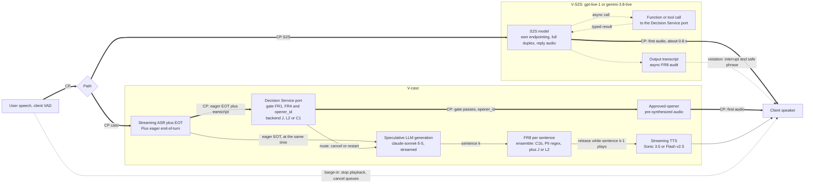

# Voice architecture: V-S2S (speech-to-speech) and V-casc (ASR → decisions → LLM → TTS)

Status: Phase 2 design, agent A1. Date 2026-10-11.
Scope:
- **V-S2S** is the LLM way's native voice design.
- **V-casc** is the cascade. It is forced for Jev, which is text-only, and is also available to the LLM way. Its decision backend is swappable behind the Decision Service port (J / L2 / C1; see `design/neutral-architecture.md` §A).
- The chat design and shared conventions are in `design/llm-architecture.md`.

**Conventions**
- Every number cites a ledger ID or carries [Guessing a–b].
- Medians only. Any p95 is a labelled placeholder; M1 owns the p95.
- Vendor latency claims are tagged [vendor] and capped at [Guessing] (LLM-056, LLM-058, LLM-059).
- **NFR-3 clock:** from the **user's last speech frame** to the **first TTS audio byte at the client**, endpointing included. Target p95 ≤ 800 ms (requirements §4).

## 0. Verdict

| Question | Answer |
|---|---|
| Does any path meet NFR-3 (p95 ≤ 800 ms) on ledger numbers? | **Only V-casc with an approved opener chosen by a *fast* decision backend** (C1, or Jev/L3 at the median; A2/A3 own those numbers). V-S2S sits at the budget at the median: about 0.8 s, press-reported (LLM-063). V-casc with L2 (LLM) decisions misses: 0.55–1.25 s median to first audio (§3) |
| Where does decision speed matter most? | (1) The **first-audio decision**: gate + opener, on NFR-3's critical path. (2) **FR8 on the first generated sentence**, and on the first sentence after a barge-in. (3) **Backchannel vs barge-in** classification, at about 100–200 ms. After the first sentence, FR8 latency is hidden by playback (§5) |
| What can S2S not do? | Structured outputs are not supported on `gpt-live-1` or `gemini-3.8-live` (LLM-062, LLM-066). So typed decisions run **outside** the S2S model, and a fail-closed per-sentence FR8 is not achievable without giving up S2S's latency advantage (§7) |
| Cost | V-casc ≈ $0.013–0.060 per call-minute; V-S2S ≈ $0.026–0.068 per minute, plus backend tokens (§8) [Guessing; derived] |
| **Recommendation (LLM advocate, honest)** | Regulated support flows → **V-casc**: LLM generation, fast decisions on the critical path, and LLM decisions async or for escalation. Low-risk conversational flows → **V-S2S** with side-channel decisions and an async FR8 audit |

## 1. Components (exact IDs)

| Path | Component | Model / product | Key facts | Source |
|---|---|---|---|---|
| V-S2S | S2S model, option 1 | `gpt-live-1` (`v1/live/sessions`) | Full duplex. **$0.05/min**, billed per second. Reasoning and tools are delegated to a backend agent, billed separately. **Structured outputs not supported.** Concurrent sessions: Build 50 / Launch 300 / Grow 500. No latency on the model page | LLM-062, ECO-028 |
| V-S2S | S2S model, option 2 | `gemini-3.8-live` | "Ultra-low latency" with no number given. **Structured outputs not supported.** Async (`NON_BLOCKING`) function calling by default; 131K input. ≈ **$0.023/min** | LLM-066, ECO-030 |
| V-S2S | S2S model, option 3 | `gpt-realtime-2.1` (Realtime API) | Audio $32 / $64 per MTok ≈ **$0.096/min**. Configurable reasoning effort ("higher … can increase latency"). Build tier 400 RPM / 200K TPM. Structured-output support not stated in the ledger | LLM-065, ECO-026, ECO-084 |
| V-casc | Streaming ASR + endpointing | Deepgram Flux `flux-general-en` / `flux-general-multi` (10 languages) | "~260 ms" end-of-turn detection [vendor]. `eot_threshold` 0.7; **`eager_eot_threshold` 0.3–0.9 enables EagerEndOfTurn**. Price $0.0065 promo / $0.0077 regular per minute | LLM-056, ECO-032 |
| V-casc | ASR, alternative | AssemblyAI Universal-3.6 Pro Streaming | Semantic end-of-turn; `min_turn_silence` 128 ms. Final transcript 307 ms median [vendor]. Price $0.0075/min (Universal-Streaming $0.0025/min) | LLM-057, LLM-058, ECO-034 |
| V-casc | Decisions | Decision Service port → L2 (`gpt-6-luna` effort `none` / `claude-haiku-5-5` thinking `disabled`), J (`jev-1.13.0`), C1a/C1b | Same 7-decision batched call and calibrated-probability thresholds as chat | llm-architecture §3–5 |
| V-casc | Generation (FR7) | `claude-sonnet-5-5` (shared mid tier), streamed | Time to first chunk 0.88 s at `low`, 100 tok/s (10k input). Small-tier proxies: 0.48 s (Haiku 4.5) and 0.83 s (Luna) | LLM-008, LLM-007, LLM-011 |
| V-casc | TTS | Cartesia Sonic 3.5; ElevenLabs Flash v2.5 | **Measured** time to first audio, including network: 128 ms and 197 ms median (n = 50, June 2026). Vendor claims are 75–90 ms excluding network. Prices: ElevenLabs Flash $0.04 per 1K characters; Deepgram Aura-2 $0.030 per 1K characters; Cartesia price not in the ledger | LLM-060, LLM-059, LLM-061, ECO-035, ECO-033 |

## 2. Voice diagram (both paths; critical path = thick `==>` edges labelled CP)

**Critical paths:**
- **V-casc:** last speech frame → eager EOT → decision gate + `opener_id` → pre-synthesized opener audio. Generation, FR8 and TTS of sentence 1 run behind the opener (§5).
- **V-S2S:** a single model hop. Decisions sit off-path by construction (§7).

The syntax was checked with `mermaid.parse` (mermaid 11.4.1).

## 3. Hop-by-hop latency budget against NFR-3 (US-region services; medians)

| Hop (from the last speech frame) | P0: V-casc naive (final EOT, sequential, L2) | P1: eager EOT + speculative generation, L2 FR8 on sentence 1 | P2: + approved opener, L2 gate | P3: + approved opener, fast gate (C1 / Jev) — reference | P4: V-S2S |
|---|---|---|---|---|---|
| End-of-turn signal | 260 ms (LLM-056) [vendor] | Eager: [Guessing 100–200 ms], before the final EOT (LLM-056) | same as P1 | same as P1 | Inside the model |
| Transcript ready | With the Flux EOT event; AssemblyAI final 307 ms (LLM-058) [vendor] | With the eager event | same | same | — |
| Decision gate (+ `opener_id`) | L2: 0.40–0.90 s (LLM-083) [Guessing] | parallel with generation | **0.40–0.90 s** | C1: ≈ 1.5–5 ms [LAB, illustrative]; Jev 0.10–0.39 s (JEV-028, JEV-030, JEV-031; probe location unstated) | — |
| Generation TTFT + first sentence | 0.48–0.88 s (LLM-007, LLM-008, LLM-011) + 15 tokens at 87–126 tok/s ≈ 0.12–0.17 s | same, overlapped with the gate | behind the opener | behind the opener | — |
| FR8 on the first generated sentence | L2: 0.30–0.60 s [Guessing] | 0.30–0.60 s | behind the opener (§5) | behind the opener | Not enforceable (§7) |
| TTS time to first audio | 128–197 ms (LLM-060) | 128–197 ms | pre-synthesized: [Guessing 20–50 ms] | same as P2 | — |
| Client network / jitter buffer | [Guessing 30–100 ms] | same | same | same | Included |
| **Total to first audio, median** | **1.7–3.1 s** | **1.2–2.1 s** | **0.55–1.25 s** | C1: **0.15–0.36 s**; Jev: **0.25–0.74 s** | **≈ 0.80 s** (LLM-063, press, [Guessing]) |
| p95 placeholder (M1 owns it) | Fail | Fail | m × the gate hop → 0.75–2.6 s: **fail** | C1 passes; Jev depends on its unknown p95 (A2) | ≈ 0.97 s if normal with σ = 104 ms (LLM-064, app-measured): **marginal fail** |
| NFR-3 verdict | ✗ | ✗ | ✗ at p95; marginal at the median | ✓ (C1); ~ (Jev) | ~ at the median; likely ✗ at p95 |
| Time to first *generated* (non-opener) audio | — | 1.2–2.1 s | 1.2–2.1 s; hidden if the opener plays ≥ that long | 0.9–1.5 s | — |

**Notes:**
- **The binding hop is not the decision; it is generation TTFT** (0.48–0.88 s; LLM-007, LLM-008, LLM-011). It is the same on every cascade, Jev included (requirements §6.4).
- The opener pattern moves NFR-3's critical path from generation onto the **decision**, which is exactly where decision speed decides pass or fail. L2 at 0.4–0.9 s misses. C1 passes, and Jev is borderline at the median.
- **S2S's 0.798 s** is "turn-taking latency" on Full Duplex Bench against an unnamed baseline (LLM-063). Its clock may not match NFR-3's, and the OpenAI page itself returned 403. The only app measurement shows a tight spread (σ 104 ms, LLM-064).
- **Humans:** a mean gap of 208 ms with a mode of 0 (LLM-068 [Likely, excerpt-sourced]). People plan their reply during the other's turn (LLM-069), which is why every machine pipeline needs prediction or speculation.
- **India:** each sequential US-hosted hop adds 194–240 ms (ECO-066, ECO-071). V-casc has 2–3 sequential hops (decision, generation, TTS), so it gains about +0.4–0.7 s [Guessing]. OpenAI has no in-India processing (LLM-043). `gpt-realtime-2.1` on Azure South India is Global Standard, i.e. processed anywhere (LLM-046). An in-region decision backend (C1, L3) removes one hop.

## 4. Eager end-of-turn detection and speculative generation

| Event (Deepgram Flux, LLM-056) | Action | Cost / risk |
|---|---|---|
| `EagerEndOfTurn` (fires at `eager_eot_threshold`, 0.3–0.9) | Snapshot the transcript. Fire the decision call (gate + opener + route) **and** speculative generation, both through the port, in parallel | Starts work about [Guessing 60–160 ms] before the final EOT (260 ms) |
| `TurnResumed` (the user keeps talking) | Cancel the decision and generation; drop the buffers; mark the attempt wasted | About $0.0018 per wasted Sonnet start (llm-architecture §3.4) × false-eager rate [Guessing 10–40% of turns] |
| `EndOfTurn` (`eot_threshold` 0.7) | Confirm. If the final transcript differs materially from the eager snapshot [Guessing: edit distance > 3 tokens], re-fire | Re-fire cost; adds latency only on a mismatch |
| No final EOT within `eot_timeout_ms` (5,000) | Force the turn | Rare |

**Tuning:**
- A lower `eager_eot_threshold` starts work earlier but produces more false starts. A higher `eot_threshold` adds latency (LLM-056).
- Sweep both on recorded calls and plot first-audio latency against waste $ per minute.
- AssemblyAI's semantic EOT (`min_turn_silence` 128 ms in `min_latency` mode, LLM-057) is the alternative.

**Speculation rules** (the same as chat, and credited to every cascade, J included):
- Speculative output is never spoken before the gate clears.
- Generation is restarted if FR2 or FR6 route to a specialist prompt.
- For a deterministic handler, generation is cancelled and the handler's templated answer goes to TTS.

## 5. Per-sentence output guardrail (FR8): where decision speed matters most

**Pipelining condition** for sentence k+1 to play without a gap:

`done(s_{k+1}) + FR8(s_{k+1}) + TTS ≤ end_of_playback(s_k)`

- Generation runs at about 100 tok/s (LLM-008), while speech consumes about 3–4 tokens/s [Guessing 2.5–4]. Generation therefore runs roughly 25–40× ahead of playback.
- **After the first sentence, FR8 latency is hidden whenever FR8 (+ TTS) < the playback time of the previous sentence** [Guessing 2–4 s per sentence].
- **The binding cases are:**
  - (a) the **first generated sentence**;
  - (b) the first sentence **after a barge-in**;
  - (c) very short sentences ("Yes.");
  - (d) the **tail**: any FR8 call slower than the slack becomes an audible gap, or a safe-phrase substitution if it hits the deadline (fail closed, requirements §4.1).

| FR8 backend (ensemble member; FR8 is never single-model) | Median per sentence | NFR-4 (p95 ≤ 150 ms) | Sentence 1 without an opener | With opener + pipelining |
|---|---|---|---|---|
| L2 (`gpt-6-luna` / `claude-haiku-5-5`, padded cached prefix) | 0.30–0.60 s [Guessing; from LLM-007, LLM-011 with a small prompt] | ✗ (2–4×) | +0.3–0.6 s audible | Hidden if the opener lasts ≥ about 1.2–2.1 s [Guessing 4–7 words]. Residual risk: tail, barge-in, short sentences |
| L2m (`claude-sonnet-5-5`) | about 1.0 s (LLM-008) | ✗ | +1 s | Needs an opener of about 2 s |
| J (`jev-1.13.0`; A2) | 0.10–0.39 s (JEV-028, JEV-030, JEV-031) | ~ (the p95 is unknown) | +0.1–0.4 s | Hidden |
| C1b in-process (A3) | p95 ≤ 27 ms on 4 vCPU (ECO-055) | ✓ | ≈ 0 | Hidden |
| PII regex / NER (deterministic) | ms [Guessing] | ✓ | ≈ 0 | Hidden |

**Design (FR8 ensemble, fail closed):**
- A sentence is released only when **all members clear it** (C1b ∥ regex ∥ an LLM or J member).
- The slowest member sets the release time, so the LLM member's 0.3–0.6 s is hidden by the opener and by pipelining, not removed.
- **If NFR-4 stays a hard p95 SLO, the LLM cannot be a blocking FR8 member.** The honest LLM-way answer is then:
  - the blocking layer is C1b + regex (+ J/L3);
  - the LLM runs as an **async** policy/tone auditor that can interrupt and correct.
- Async is acceptable for tone. It is **not** acceptable for PII or policy, which must stay on the blocking layer. This is the point where decision speed matters most, and the LLM way concedes it.

## 6. Barge-in and interruption handling

| Aspect | V-casc | V-S2S |
|---|---|---|
| Detection | Client-side VAD plus ASR speech-start. On-device VAD is preferred (phase-0 critic recommendation 8) | Native full duplex |
| Stop playback | On the client, immediately [Guessing < 100 ms] | GPT-Live took about 1.4 s to yield when interrupted in the ChatGPT app, 498 ms slower than Advanced Voice (LLM-064, n = 30, one location) |
| Backchannel ("uh-huh") vs a real interruption | A turn-taking decision (scenario S5) that needs about 100–200 ms: use Flux `TurnResumed` / the ASR's turn model or an on-device classifier. **An LLM API (0.4–0.9 s) is too slow here, and so is a remote Jev call once network is added** | Model-native |
| Context repair | Truncate the assistant transcript at the last played character offset, so history matches what the user heard. Cancel the generation, FR8 and TTS queues. Log the interruption | Session-managed [unverified in the ledger] |
| Re-plan | New turn: eager EOT → gate → a short acknowledgement opener ("Sure—"). **Sentence 1 after a barge-in pays FR8 latency** unless an opener covers it | Model-native; no per-sentence hold |
| Packet loss | — | Under 10% uplink loss: +314 ms for GPT-Live vs +2,448 ms for Advanced Voice (LLM-064) |

## 7. What S2S models cannot do, and how decisions run anyway

| Capability | `gpt-live-1` | `gemini-3.8-live` | Consequence |
|---|---|---|---|
| Structured outputs / enum-constrained decisions | **Not supported** (LLM-062) | **Not supported** (LLM-066) | No typed decision inside the session, so FR1 to FR6 and FR8 must run elsewhere |
| Tools | Delegated to a backend agent, billed separately (LLM-062) | Async `NON_BLOCKING` function calls by default (LLM-066) | Decisions become tool calls to the Decision Service port |
| Token logprobs / confidence | Not stated | Not stated | No native confidence; it comes from the port's backend |
| Published latency | Press only: 0.798 s (LLM-063) | None (LLM-066) | Must be measured in shadow |
| Capacity | 50 / 300 / 500 concurrent sessions (LLM-062) | Not in the ledger | §9 |
| India processing | None (LLM-043) | Not in the ledger (Vertex `asia-south1` lists only 2.5/3.5 Flash, LLM-053) | US/EU only |

**Side-channel decision designs for V-S2S:**

| Design | How | Good for | Fails at |
|---|---|---|---|
| (a) Pre-response gate | Tee the user audio to streaming ASR → port (FR1, FR4) → let the S2S model respond only after "go" [unverified that each provider supports a manual response trigger] | Fail-closed FR1/FR4 | Adds the gate (0.4–0.9 s on L2) **in front of** S2S's 0.8 s, which loses S2S's latency advantage. With a C1/J gate the penalty is smaller |
| (b) Model-invoked tool | The S2S model calls `check_eligibility` or `route_intent`; the port returns a typed answer; with Gemini `NON_BLOCKING` the model keeps talking ("let me check…") | FR5, FR6, FR2 routing, multi-hop policy via L2m/L1b | FR1/FR4: **the model decides whether to call**, so it is not a guardrail |
| (c) Async output audit | Output transcript → FR8 ensemble → on a violation, interrupt + safe phrase + log | Tone; low-risk policy | **Fail-open for the sentence already spoken.** This violates FR8's fail-closed rule (requirements §4.1) |

**Conclusion:** V-S2S is the LLM way's best latency and naturalness story. It is acceptable only where an async FR8 is acceptable. Refund, PII and safety flows go to V-casc.

## 8. Cost per call-minute (derived; [Guessing] shape: 3–6 user turns/min, the assistant speaking 40–60% of the time, ≈ 700–1,000 characters per minute of speech)

| Line item | V-casc low | V-casc central | V-casc high | Source |
|---|---|---|---|---|
| Streaming ASR | $0.0025 (AssemblyAI Universal-Streaming) | $0.0077 (Flux, regular price) | $0.017 (`gpt-live-transcribe`) | ECO-034, ECO-032, ECO-029 |
| TTS | $0.0036 (Gemini Flash-Lite TTS ≈ $0.009 per audio-minute × 40%) | $0.016 (ElevenLabs Flash, 400 characters) | $0.024 (600 characters) | ECO-031, ECO-035 |
| LLM generation (`claude-sonnet-5-5`; 3,000 cached + 500 input tokens; 60–100 output per turn) | $0.0057 | $0.0084 | $0.0138 | ECO-004, R3 BoE shape |
| Decisions (L2 call A + 3 FR8 sentences per turn) | $0.0005 | $0.0007 | $0.0010 | ECO-001; llm-architecture §3.2 |
| Speculation / false-eager waste | $0.0006 | $0.0008 | $0.0041 | §4 |
| **V-casc total** | **$0.013** | **$0.034** | **$0.060** | derived |

| V-S2S option | Base | + side channel (ASR tee + decisions) | Note |
|---|---|---|---|
| `gpt-live-1` | $0.05/min (ECO-028) | $0.053–0.068 | **+ backend-agent tokens** (LLM-062), share unknown |
| `gemini-3.8-live` | ≈ $0.023/min (ECO-030) | $0.026–0.041 | Gemini 3.8 Flash-family prices double from 2027-01-01 (ECO-023); whether Live follows is not in the ledger |
| `gpt-realtime-2.1` / `-mini` | ≈ $0.096 / $0.030 per min (ECO-084) | $0.099–0.114 / $0.033–0.048 | Context re-billed every turn (ECO-026) |

**Notes:**
- R3's "S2S costs about 5–15× a cascade" (R3 bullet 8) compares S2S audio with ASR + TTS only. **Once the cascade's own LLM generation is included, the ranges overlap** (about 0.4–5×) [Guessing].
- Decisions are ≤ 3% of the V-casc minute on any small-tier backend [Guessing], so in voice **the decision backend is chosen on latency, not price**.

## 9. Capacity

| Constraint | 1M turns/day | 10M | 50M | Basis |
|---|---|---|---|---|
| Concurrent S2S sessions at peak (4 turns/min [Guessing 3–6]; 3.5× peak, requirements §5) | 608 | 6,076 | 30,382 | derived |
| Headroom on `gpt-live-1` Grow (500 sessions, LLM-062) | **0.82×** | 0.08× | 0.02× | **Binds even at 1M/day** |
| `gpt-realtime-2.1` Build tier | 400 RPM / 200K TPM (LLM-065) | | | Higher tiers not in the ledger |
| V-casc decisions on Haiku Scale (1 call A + about 3 FR8 calls per turn [Guessing 2–5]) | 1.03× | 0.10× | 0.02× | LLM-030; worse than chat because FR8 runs per sentence |
| V-casc decisions on Luna Grow, same request count | 3.1× | 0.31× | 0.06× | LLM-038 |

**Takeaways:**
- Every hosted option needs negotiated limits from 10M/day (requirements §5.2).
- In voice, the **per-sentence** FR8 multiplies request rate, which favours an in-process C1b member (A3) for the blocking FR8 layer.

## 10. Failure modes

| Failure | Path | Detection | Mitigation | Fail mode |
|---|---|---|---|---|
| False eager EOT: the user resumes | casc | `TurnResumed` | Cancel; count waste; tune the threshold (§4) | — |
| Endpointing too eager (cuts the user off) or too slow | both | Barge-in-after-reply rate; latency | Tune `eot_threshold`; semantic EOT (LLM-057) | — |
| Decision gate misses the 250 ms deadline (L2 at the median) | casc | Deadline counter | The C1b member alone at a stricter τ; FR4/FR5 fail closed; opener = a neutral acknowledgement | §4.1 |
| FR8 slower than the slack | casc | Hold-time histogram | Safe phrase; longer opener; faster blocking member | **Closed** |
| S2S says something non-compliant | S2S | Async FR8 audit | Interrupt, safe phrase, log, route the flow to V-casc | **Open** for the spoken sentence (§7) |
| S2S tool call is slow | S2S | Tool latency | `NON_BLOCKING` plus filler (Gemini); a cached port result | — |
| Concurrency cap reached (`gpt-live-1`: 500 on Grow) | S2S | 429 / session refusals | Overflow to V-casc; negotiate a tier | Degrade to cascade |
| 429/529 or an outage at the ASR, LLM or TTS vendor | casc | Breaker | A second ASR (AssemblyAI ⇄ Flux) and a second TTS (Sonic ⇄ Flash); LLM hedge (llm-architecture §3.6) | Degrade; a canned "one moment" |
| ASR errors on Hindi or code-mixed speech | both | WER on the language slice | `flux-general-multi` covers 10 languages (LLM-056); AssemblyAI multilingual streaming has no Indian languages (ECO-034) | Route to the LLM path (handles noisy text better [Guessing]) or a human |
| Packet loss | both | RTP stats | GPT-Live degrades by +314 ms at 10% loss (LLM-064) | — |
| Refusal on the decision call (harmful input) | casc | `stop_reason: "refusal"` (LLM-033) | Treat as FR1-positive | **Closed** |
| Version drift (S2S or LLM) | both | Golden-audio canary | Pin IDs; recalibrate the port maps | — |

## 11. Observability and evaluation specifics for voice
- **Per-turn timeline**, all on one clock:
  - last speech frame (client VAD timestamp); eager EOT; final EOT
  - gate ready; opener start
  - generation TTFT
  - each sentence's FR8 start and end, and its TTS time to first audio
  - first audio at the client; barge-in times
- **Report:** NFR-3 p50/p95/p99 by region; time to the first *generated* audio; false-eager rate; FR8 hold and safe-phrase rate; barge-in stop latency; and $ per minute split as in §8.
- **Golden audio set:** recorded or synthesized calls with timing, covering the English, Hindi/code-mixed, noisy-line and injection-by-voice slices. Replay at real-time speed. Then shadow → canary → ramp, the same as chat (llm-architecture §8).

## 12. Security and residency (voice-specific)
- **Spoken PII:** card numbers or dates of birth arrive in the ASR stream. Redact them before any decision or LLM call that does not need them, and keep audio retention minimal.
- **ZDR:** OpenAI realtime and audio endpoints are ZDR-eligible (LLM-043). `gpt-live-1`'s `v1/live/sessions` endpoint is not named in the ledger [unverified].
- **Injection by voice:** "ignore your instructions" can be spoken. The FR1 ensemble (C1b ∥ the port backend) applies to the transcript. V-S2S has no pre-response gate unless design (a) in §7 is used.
- **Residency:** the same constraints as chat (llm-architecture §9). There is **no in-India S2S or current-generation LLM processing** (ECO-089, LLM-043), so India voice pays 194–240 ms per hop (ECO-066, ECO-071) unless the cascade's decisions and TTS run in-region.

## 13. Gaps
- No measured S2S latency matching NFR-3's clock. No latency at all for `gemini-3.8-live`.
- No ledger data on S2S manual response triggers, output-audio holding, or ZDR for `gpt-live-1`.
- Small-prompt TTFT for LLM FR8 calls (the 0.3–0.6 s figure is [Guessing]).
- Speech rate and sentence length for the pipelining slack: measure them on the golden audio.
